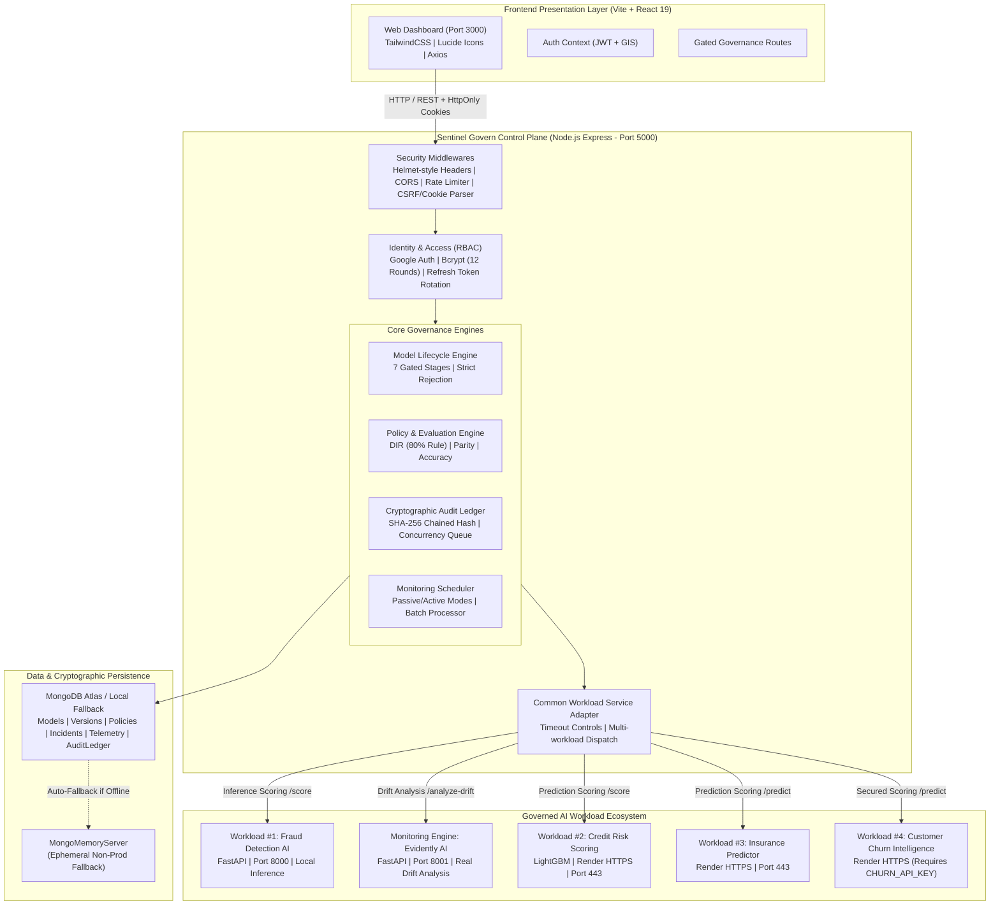
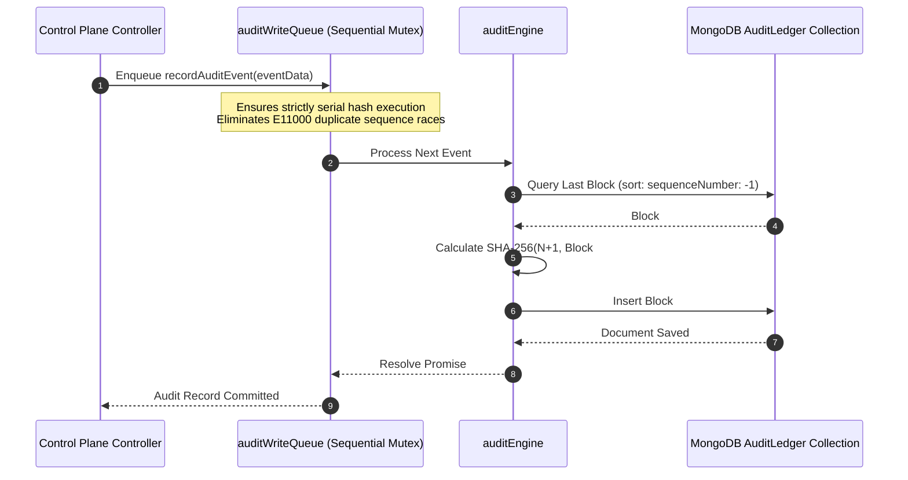

# Sentinel Govern — System Architecture & Implementation Blueprint

*Platform Version:* 1.0.0-PROD-CANDIDATE  
*Status:* Authoritative Architecture Specification  
*Updated:* October 2026

---

## 1. Executive Architectural Overview

Sentinel Govern is an enterprise-grade AI Governance, Risk, and Compliance (GRC) Control Plane. Designed to operationalize the European Union Artificial Intelligence Act (EU AI Act Annex III), the NIST AI Risk Management Framework (NIST AI RMF 1.0), and ISO/IEC 42001, Sentinel Govern enforces immutable stage gates, dual-engine distribution drift analysis, multi-stakeholder governance approval consensus, and SHA-256 chained cryptographic audit trails across machine learning lifecycles.

---

## 2. Component Subsystems

### 2.1 Presentation Tier (Frontend)
- **Framework:** React 19.x with Vite 6.x.
- **Routing:** React Router DOM v6 with role-aware layout guards (`ProtectedRoute`, `AdminRoute`, `PendingVerificationNotice`).
- **Styling:** Tailwind CSS with high-density enterprise typography, zero decorative synthetic charting animations, and authoritative tabular review interfaces.
- **Build Output:** Production bundle optimized into static HTML/CSS/JS in `/dist` without build-time warnings.

### 2.2 Control Plane Tier (Backend)
- **Runtime:** Node.js (ES Module architecture) with Express 4.21.
- **Security Middleware:** Custom Helmet-equivalent HTTP headers (`Content-Security-Policy`, `X-Content-Type-Options: nosniff`, `X-Frame-Options: DENY`, `Strict-Transport-Security`), in-memory IP sliding-window rate limiters, and strict CORS white-listing.
- **Database Layer:** Mongoose 8.x with schemas enforcing typed indexes, compound unique constraints, and automated retry mechanisms for chained ledgers.

### 2.3 Persistence Architecture & High-Availability Fallback
- **Primary Database:** MongoDB Atlas cluster with TLS/SSL encryption and connection timeout controls (5000ms server selection).
- **Graceful Ephemeral Fallback:** When network boundaries (such as restrictive enterprise/academic Wi-Fi) block outbound SRV DNS queries or port 27017, the application automatically spawns an ephemeral `MongoMemoryServer` instance in non-production environments.
- **Production Guard:** In `NODE_ENV=production`, fallback is strictly prohibited; the server terminates immediately with a diagnostic breakdown if the primary connection fails.

---

## 3. Cryptographic Audit Trail Architecture

The Sentinel Govern audit ledger implements a verifiable SHA-256 block chain storing every state mutation across models, policies, approvals, telemetry ingestions, and user account actions.

---

## 4. Workload Integration Architecture

Sentinel Govern implements the architectural principle:  
> *"The AI model does the AI work. Sentinel Govern governs the AI model."*

1. **Decoupled Workload Interfaces:** Sentinel Govern does not run model weights inside the control plane. It interfaces via HTTP/REST against distinct microservices.
2. **Evidently AI Statistical Ground Truth:** Rather than fabricating synthetic drift metrics, runtime monitoring batches are dispatched to Evidently AI (`port 8001`), which evaluates statistical tests (Wasserstein distance, Kolmogorov-Smirnov test, Jensen-Shannon divergence) against immutable baseline CSVs.
3. **Passive Scheduler:** The background telemetry scheduler operates passively by default (`REAL` mode), observing external workloads without generating synthetic spam.
