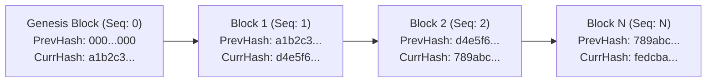

# Aegis AI — Cryptographic Audit Trail & Compliance Dossier

This document details the immutable SHA-256 hash-chained audit ledger, cryptographic verification mechanics, tamper simulation controls, and the 1-click Compliance Dossier compilation engine.

---

## 1. Cryptographic Audit Ledger Architecture

Aegis AI implements a cryptographically sealed, immutable ledger modelled after blockchain mechanics in [backend/src/services/auditEngine.js](file:///d:/Projects/ai%20govern/backend/src/services/auditEngine.js).



### 1. Data Schema ([backend/src/models/AuditLedger.js](file:///d:/Projects/ai%20govern/backend/src/models/AuditLedger.js)):
- `sequenceNumber`: Monotonically increasing unique integer ($0, 1, 2, \dots$).
- `previousHash`: The 64-character SHA-256 hexadecimal hash of the immediately preceding block.
- `currentHash`: The SHA-256 cryptographic digest of the current block.
- `timestamp`: ISO 8601 UTC timestamp.
- `actor`: Email or identity of the initiating user (derived strictly from `req.user.email`).
- `role`: Authenticated role of the actor at the moment of execution.
- `action`: Enumerated governance action (38 supported actions).
- `entityType`: Target entity (e.g. `'Model'`, `'ModelVersion'`, `'User'`, `'Policy'`).
- `entityId`: String ID of the affected resource.
- `payload`: Normalized, canonical JSON object containing execution details.

### 2. Cryptographic Block Hashing Formula:
$$\text{CanonicalPayload} = \text{JSON.stringify}(\text{payload}, \text{Object.keys}(\text{payload}).\text{sort}())$$

$$\text{Header} = \text{previousHash} \parallel \text{timestamp.toISOString()} \parallel \text{actor} \parallel \text{action} \parallel \text{CanonicalPayload}$$

$$\text{currentHash} = \text{crypto.createHash('sha256').update}(\text{Header})\text{.digest('hex')}$$

- **Genesis Block Constant:** `GENESIS_PREVIOUS_HASH = '0'.repeat(64)` (64 zeros).

---

## 2. Live Cryptographic Integrity Verification

The endpoint `GET /api/audit/integrity` runs `verifyAuditChainIntegrity()` across the entire database:
1. Validates that the Genesis block (`sequenceNumber: 0`) has `previousHash === '0'.repeat(64)`.
2. Validates that every subsequent block $i$ has `previousHash === block_{i-1}.currentHash`.
3. Re-computes the SHA-256 digest for every single block using its stored headers and payload.
4. If any payload, actor, or timestamp has been modified directly in MongoDB, the recalculated hash fails to match `currentHash`.
5. Returns `{ valid: false, brokenAtSequence: i, message: "Block i payload or header has been tampered with..." }`.

---

## 3. Tamper Simulation & Repair Controls

To verify and demonstrate active tamper detection, Aegis AI provides:
- `POST /api/audit/simulate-tamper`: Modifies a block payload directly without re-hashing, immediately breaking verification.
- `POST /api/audit/repair`: Sequentially re-computes and re-seals hashes from the break point forward.

### Production Environment Protection:
> **Critical Security Guard:** Audit tamper simulation and repair are **STRICTLY PROHIBITED in production environments**.

Enforced by `requireDemoAuditEnabled` in [authMiddleware.js](file:///d:/Projects/ai%20govern/backend/src/middleware/authMiddleware.js):
```javascript
const isDev = process.env.NODE_ENV !== 'production';
const isDemoEnabled = process.env.ENABLE_AUDIT_TAMPER_DEMO === 'true';

if (!isDev || !isDemoEnabled) {
  return res.status(403).json({
    success: false,
    error: 'Audit tamper simulation and hash repair are strictly disabled in production environments to guarantee immutable ledger integrity.'
  });
}
```

---

## 4. 1-Click Regulatory Compliance Dossier

Compiled by [backend/src/services/reportService.js](file:///d:/Projects/ai%20govern/backend/src/services/reportService.js) via `GET /api/audit/dossier/:modelId/:versionId?`.

### Strict "No Fabrication" Rule:
If a metric, approval, or risk assessment is missing in the database, the dossier engine **NEVER fabricates or mocks values**. It returns empty arrays or `null` entries with explicit warnings that evidence has not been recorded.

### 10 Statutory Sections (EU AI Act Annex IV & NIST AI RMF):
1. **Executive Summary & Model Identity:** Model name, purpose, risk level, current status, owner.
2. **System Architecture & Operational Specifications:** Model type, parameters, intended users, autonomy level.
3. **Training Data Governance & Provenance:** Lineage, sample count, feature count, dataset hashes.
4. **Statistical Fairness & Non-Discrimination Audit:** Disparate Impact Ratio, Demographic Parity Diff, Equalized Odds.
5. **Predictive Performance Benchmarking:** Accuracy, Precision, Recall, F1, ROC-AUC.
6. **Governance Policy Evaluation & Stage Gates:** Active policy thresholds, gate decisions, failure actions.
7. **Multi-Stakeholder Sign-Offs & Human Oversight:** Approver names, roles, timestamps, sign-off comments.
8. **Runtime Monitoring & Distribution Drift:** Telemetry batches, baseline comparison, PSI scores.
9. **Incident Management & Post-Market Surveillance:** Incident logs, investigation notes, mitigation rollbacks.
10. **Cryptographic Audit Digest:** SHA-256 chain integrity status, total blocks verified.

### Export Formats:
- **JSON:** Machine-readable regulatory submission payload.
- **Markdown:** Formatted legal documentation artifact with statutory notices.
- **PDF-Ready Print:** Clean HTML print styles accessible via browser print dialogue in the UI.
