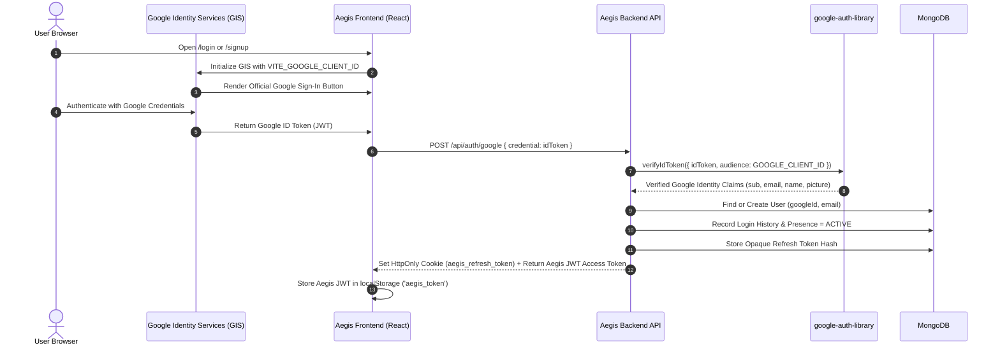
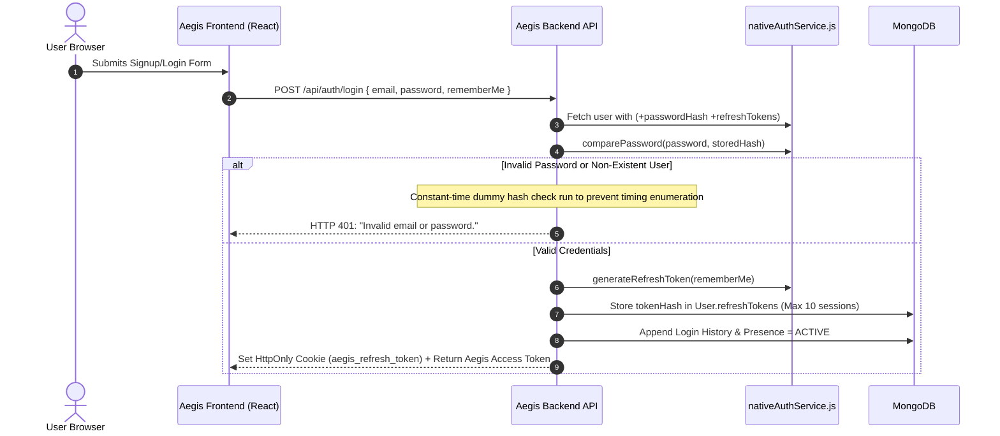

# Aegis AI — Authentication System Architecture

Aegis AI implements a dual authentication architecture providing both **Google Identity Services (GIS)** OAuth2 single sign-on and **Native Email/Password** authentication with cryptographically secure session rotation.

---

## 1. Google Identity Services (GIS) Authentication

### Architectural Flow:

### Verification & Validation Protocol (`googleAuthService.js`):
The backend verifies the Google ID token using official `google-auth-library` with strict cryptographic checks:
1. **Audience Validation:** `payload.aud` must strictly match `process.env.GOOGLE_CLIENT_ID`. Mismatches throw an audience mismatch error.
2. **Issuer Validation:** `payload.iss` must be either `'accounts.google.com'` or `'https://accounts.google.com'`.
3. **Expiration Validation:** `payload.exp * 1000 > Date.now()`. Expired tokens are rejected immediately.
4. **Subject (sub) Claim:** Verified to exist and mapped to `user.googleId`.
5. **Email Claim:** Verified to exist, lowercased, and sanitized.

### Bootstrap Administrator Auto-Provisioning:
- If the verified email matches `process.env.BOOTSTRAP_ADMIN_EMAIL` (trimmed, lowercase):
  - User is automatically assigned `role: 'PLATFORM_ADMIN'`.
  - Account `verificationStatus` is set to `'VERIFIED'`.
  - `status` is set to `'ACTIVE'`.
  - `onboardingCompleted` is set to `true`.
- For standard users registering via Google:
  - Initial `role: 'EMPLOYEE'`.
  - Initial `status: 'ACTIVE'`.
  - Initial `verificationStatus: 'PENDING'`.
  - Initial `onboardingCompleted: false`.

### Frontend GIS Button Integration (`GoogleSignInButton.jsx`):
- Initializes Google script from `https://accounts.google.com/gsi/client`.
- Renders the official Google button into a container with `theme: 'filled_blue'`, `size: 'large'`, `text: 'signin_with'`.
- Handles credential response by calling `loginWithGoogle(credential)`.

---

## 2. Native Email/Password Authentication

### Architectural Flow:

### Password Hashing & Security:
- **Algorithm:** Bcrypt via `bcryptjs` with **12 work factor rounds**.
- **Strength Validation:** Mandatory minimum 8 characters, at least 1 uppercase letter, 1 lowercase letter, and 1 digit (`validatePasswordStrength`).
- **Database Field:** `passwordHash` is configured with `select: false` in Mongoose schema. It is never exposed in queries or API responses.

### Refresh Token Lifecycle & Rotation:
- **Access Token:** Short-lived JWT signed with `JWT_SECRET` (TTL configured via `JWT_EXPIRES_IN`, default 7 days).
- **Refresh Token:** Cryptographically secure 48-byte random hex string (`crypto.randomBytes(48)`).
- **Storage:** Only the SHA-256 hash of the token is stored in MongoDB (`User.refreshTokens[].tokenHash`).
- **Delivery:** Raw token is transmitted exclusively in an `HttpOnly`, `SameSite`, path-restricted cookie (`/api/auth`).
- **Rotation on Use:** Each call to `POST /api/auth/refresh` consumes the incoming refresh token, removes its hash, generates a new token pair, and rotates the cookie.
- **Session Limits:** User documents maintain a maximum of 10 concurrent refresh sessions, evicting the oldest session when the ceiling is reached.
- **Remember Me Control:**
  - Session TTL (Remember Me = false): **1 day** (`24 hours`).
  - Persistent TTL (Remember Me = true): **30 days**.

### Password Reset Flow:
- Endpoint `POST /api/auth/forgot-password`:
  - Validates email; always returns HTTP 200 with generic success message to prevent user enumeration.
  - If user exists and has a native password, generates a 32-byte secure token with a 1-hour TTL (`60 * 60 * 1000 ms`).
  - In non-production environments (`process.env.NODE_ENV !== 'production'`), the raw reset token is returned in `_devResetToken` to facilitate testing.
  - *Production Status:* Real SMTP email transmission is **DEFERRED**; email delivery service integration is pending production setup.
- Endpoint `POST /api/auth/reset-password`:
  - Validates token hash and expiration.
  - Hashes new password with Bcrypt (12 rounds).
  - Invalidates all existing refresh tokens (`user.refreshTokens = []`), forcing re-login across all active sessions.

### Rate Limiting Controls (`securityMiddleware.js`):
1. **General Authentication Rate Limiter:** 50 requests per 15 minutes per IP (`authRateLimiter`).
2. **Login & Signup Rate Limiter:** 20 requests per 15 minutes per IP (`loginRateLimiter`).
3. **Password Reset Rate Limiter:** 5 requests per 60 minutes per IP (`resetRateLimiter`).

---

## 3. Session State & Client-Side Token Storage

- **Access Token:** Stored in browser `localStorage` as `'aegis_token'`. Included in all authenticated API requests as `Authorization: Bearer <token>`.
- **Refresh Token:** Stored exclusively in the browser's cookie jar with `HttpOnly: true`. Inaccessible to client JavaScript, preventing XSS-based token theft.
- **Silent Refresh:** When an API request returns HTTP 401, the client fires an `aegis:unauthorized` window event which triggers a silent refresh attempt via `POST /api/auth/refresh`. If refresh succeeds, the new token is stored and the session continues uninterrupted.
