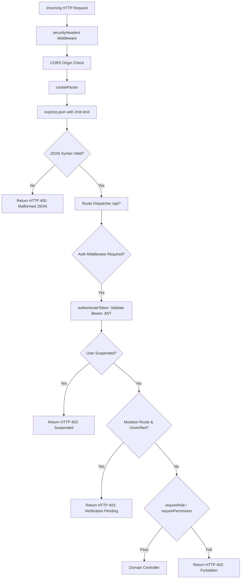

# Aegis AI — Backend Architecture & Service Engineering

This document details the backend architecture, middleware pipelines, service catalog, database reset tools, and security mechanisms of the Aegis AI Control Plane.

---

## 1. Runtime Environment & Startup Sequence

- **Runtime:** Node.js (v18+ / verified v24.18) with ECMAScript Modules (`import` / `export`).
- **Framework:** Express.js v4.21.2
- **Port:** Configured via `process.env.PORT` (defaults to `5000`).

### Server Startup Flow (`server.js`):
1. **Load Environment:** Initializes `dotenv.config()`.
2. **Apply Global Middleware:** `securityHeaders`, `cors`, `cookieParser`, `express.json({ limit: '2mb' })`.
3. **Handle Malformed Payloads:** Catches JSON syntax parsing errors.
4. **Mount REST Routes:** Mounts consolidated routes at `/api`.
5. **Register Error Handlers:** Catches Mongoose `CastError`, `ValidationError`, and generic 500 errors.
6. **Connect Database:** Calls `connectDB()` in [backend/src/config/db.js](file:///d:/Projects/govern/backend/src/config/db.js).
7. **Seed Baseline Data:** Calls `seedDatabase()` in [backend/src/seed/seedData.js](file:///d:/Projects/govern/backend/src/seed/seedData.js) if database is unpopulated.
8. **Listen on Port:** Binds HTTP listener. (Bypassed when `NODE_ENV === 'test'`).

### Database Maintenance Scripts:
- **`npm run db:reset` ([backend/src/seed/resetDevDb.js](file:///d:/Projects/govern/backend/src/seed/resetDevDb.js)):** Drops operational collections and reseeds clean baseline models, versions, policies, and users. Protected by a hard `if (process.env.NODE_ENV === 'production') throw ...` check.

---

## 2. Middleware Architecture

### Key Middlewares:
1. **`securityHeaders` ([securityMiddleware.js](file:///d:/Projects/govern/backend/src/middleware/securityMiddleware.js)):** Applies defense-in-depth headers:
   - `X-Content-Type-Options: nosniff`
   - `X-Frame-Options: DENY`
   - `X-XSS-Protection: 1; mode=block`
   - `Referrer-Policy: strict-origin-when-cross-origin`
2. **`authenticateToken` ([authMiddleware.js](file:///d:/Projects/govern/backend/src/middleware/authMiddleware.js)):** Verifies JWT signature using `getJwtSecret()`; populates `req.user`.
3. **`requireActiveUser`:** Blocks suspended accounts (`status === 'SUSPENDED'`).
4. **`requireVerifiedUser`:** Blocks pending accounts from executing mutations (`verificationStatus === 'PENDING'`), while preserving read privileges.
5. **`requireRole(roles)`:** Ensures `req.user.role` matches specified roles. Platform Admin cannot bypass domain roles.
6. **`requirePermission(permission)`:** Validates against the 26-permission matrix in `permissions.js`.
7. **`requireApprovalSignoffRole`:** Strictly enforces identity matching: users can only submit approvals for their own authenticated role.
8. **`requireDemoAuditEnabled`:** Rejects audit tampering and repair unless non-production and `ENABLE_AUDIT_TAMPER_DEMO=true`.
9. **`handleFileUpload(field)` ([uploadMiddleware.js](file:///d:/Projects/govern/backend/src/middleware/uploadMiddleware.js)):** Multer middleware using memory storage (`storage: multer.memoryStorage()`) with a 10MB limit and file extension validation (`.csv`, `.xlsx`, `.xls`).

---

## 3. Backend Services Catalog

| Service File | Purpose & Responsibilities | Key Exported Functions |
|---|---|---|
| **`googleAuthService.js`** | Verifies Google Identity Services tokens and signs Aegis session JWTs. | `verifyGoogleIdToken`, `generateAegisToken`, `verifyAegisToken`, `getJwtSecret` |
| **`nativeAuthService.js`** | Email/password hashing, refresh token rotation, password reset tokens. | `hashPassword`, `comparePassword`, `generateRefreshToken`, `storeRefreshToken`, `rotateRefreshToken`, `validatePasswordStrength` |
| **`lifecycleService.js`** | State transitions and gating rules for model versions across 3 domain approvers. | `transitionVersionLifecycle`, `LIFECYCLE_STAGES` |
| **`policyEngine.js`** | Evaluates fairness and performance against stored governance policies. | `evaluatePolicyGates` |
| **`fairnessEngine.js`** | Computes Disparate Impact Ratio, Demographic Parity Diff, and Equalized Odds. | `calculateDisparateImpactRatio`, `calculateDemographicParityDifference`, `evaluateModelMetrics` |
| **`driftEngine.js`** | Computes Population Stability Index (PSI) and generates test telemetry batches. | `calculatePSI`, `evaluateDriftStatus`, `generateTelemetryBatch` |
| **`runtimeMonitoringService.js`** | Orchestrates real Evidently AI (0.7.23) drift analysis ingestion without fabricated PSI. | `ingestRuntimeTelemetryBatch` |
| **`externalAiAdapter.js`** | Outbound HTTP client bridging external FastAPI model scoring (`http://127.0.0.1:8000`). | `checkExternalAiHealth`, `scoreTransactionWithExternalAi`, `scoreBatchWithExternalAi` |
| **`evaluationImportService.js`** | In-memory parsing of benchmark datasets (.csv/.xlsx) via SheetJS. Non-training. | `parseAndValidateEvaluationFile`, `parseBinaryLabel` |
| **`incidentService.js`** | Generates drift incidents (with deduplication) and executes atomic version rollbacks. | `createDriftIncident`, `executeRollback` |
| **`issueService.js`** | Handles employee issue reporting, triage, and bidirectional escalation to formal incidents. | `createIssueReport`, `getIssueReports`, `getIssueReportById`, `updateIssueReport`, `escalateIssueToIncident` |
| **`reportService.js`** | Compiles 10-section regulatory compliance dossiers. Enforces no fabrication. | `compileGovernanceDossier` |
| **`auditEngine.js`** | Manages SHA-256 chained hash blocks, integrity checks, and tamper simulation. | `recordAuditEvent`, `verifyAuditChainIntegrity`, `computeBlockHash`, `simulateTamperOnBlock`, `repairAuditChain` |

---

## 4. Error Handling & Parameter Validation

- **ObjectId Validation:** Routes validate 24-character hexadecimal IDs via parameter middleware (`router.param('id', validateParamId)`). Malformed IDs immediately return HTTP 400.
- **Mongoose CastError & ValidationError:** Mapped cleanly in the global error handler to HTTP 400 with descriptive error messages.
- **Production Information Leakage Prevention:** When `NODE_ENV === 'production'`, internal stack traces are suppressed, returning generic `Internal Server Error` messages while preserving structured error logging server-side.
