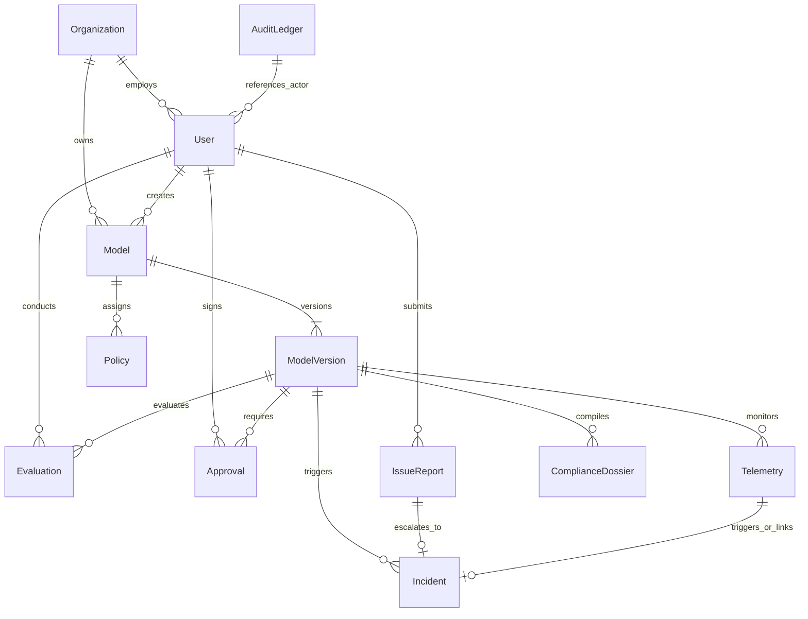

# Aegis AI — Database Architecture & Data Models

This document provides the authoritative reference for the database layer in Aegis AI, detailing connection mechanics, Atlas configurations, safe development reset scripts, and the complete inventory of 15 Mongoose schemas.

---

## 1. Database Configuration & Connection Mechanics

- **Database Engine:** MongoDB (compatible with MongoDB 6.0+ and 7.0+)
- **Primary Cluster:** MongoDB Atlas
  - Host: `cluster0.v4pvm60.mongodb.net`
  - Canonical Database Name: `ai_govern`
  - URI Format: `mongodb+srv://<username>:<password>@cluster0.v4pvm60.mongodb.net/ai_govern?retryWrites=true&w=majority&appName=Cluster0`
- **ODM:** Mongoose v8.9.5
- **Connection Logic ([backend/src/config/db.js](file:///d:/Projects/govern/backend/src/config/db.js)):**
  - Attempts external connection with `serverSelectionTimeoutMS: 5000`.
  - **Ephemeral Local Fallback:** If `MONGODB_URI` is unset or unreachable within 5 seconds, it automatically starts `mongodb-memory-server` (v10.1.3).
  - *Data Persistence Note:* In-memory data resets when the Node process terminates. External Atlas connections provide persistent storage.
- **Safe Development DB Reset ([backend/src/seed/resetDevDb.js](file:///d:/Projects/govern/backend/src/seed/resetDevDb.js)):**
  - Invoked via `npm run db:reset`.
  - Clears stale operational state (models, versions, evaluations, policies, telemetry, incidents, issue reports, dossiers) and re-seeds baseline data.
  - **Strict Production Safeguard:** Immediately throws an exception if `process.env.NODE_ENV === 'production'`.

---

## 2. Complete Schema Inventory (15 Models)

### 1. `User` ([backend/src/models/User.js](file:///d:/Projects/govern/backend/src/models/User.js))
- **Primary Fields:**
  - `email` (String, required, unique, lowercase, indexed)
  - `name` (String, required, trim)
  - `googleId` (String, unique, sparse, indexed)
  - `avatar` (String, default: '')
  - `passwordHash` (String, `select: false`)
  - `refreshTokens` (Array of `{ tokenHash, expiresAt, createdAt }`, `select: false`)
  - `passwordResetTokenHash` (String, `select: false`)
  - `passwordResetExpiresAt` (Date)
  - `role` (String, enum: `['PLATFORM_ADMIN', 'ML_LEAD', 'GOVERNANCE_OFFICER', 'EXECUTIVE_APPROVER']`, default: `'GOVERNANCE_OFFICER'`, required: true)
  - `status` (String, enum: `['PENDING', 'ACTIVE', 'SUSPENDED']`, default: `'ACTIVE'`, required: true)
  - `verificationStatus` (String, enum: `['PENDING', 'VERIFIED']`, default: `'PENDING'`, indexed)
  - `verifiedBy` (String, default: null)
  - `verifiedAt` (Date, default: null)
  - `presence` (String, enum: `['ACTIVE', 'OFFLINE']`, default: `'OFFLINE'`, indexed)
  - `department` (String, default: `'Engineering'`)
  - `team` (String, default: '')
  - `teamLead` (String, default: '')
  - `onboardingCompleted` (Boolean, default: false)
  - `loginHistory` (Array of `{ loginAt, logoutAt, authProvider, userAgent, ip, sessionId }`)
- **Indexes:** `{ email: 1, status: 1 }`, `{ googleId: 1 }`.

### 2. `Model` ([backend/src/models/Model.js](file:///d:/Projects/govern/backend/src/models/Model.js))
- **Primary Fields:**
  - `name` (String, required, unique, trim)
  - `description` (String, required)
  - `purpose` (String, required)
  - `owner` (String, required)
  - `team` (String, required)
  - `modelType` (String, enum: `['CLASSIFICATION', 'REGRESSION', 'LLM_GENERATIVE', 'RECOMMENDER', 'OTHER']`, default: `'CLASSIFICATION'`)
  - `riskLevel` (String, enum: `['UNACCEPTABLE', 'HIGH', 'LIMITED', 'MINIMAL']`, default: `'HIGH'`)
  - `lifecycleStatus` (String, enum: `['DRAFT', 'UNDER_REVIEW', 'EVALUATION', 'PENDING_APPROVAL', 'APPROVED', 'IN_PRODUCTION', 'DEPRECATED']`, default: `'DRAFT'`)
  - `currentProductionVersionId` (ObjectId ref `ModelVersion`, default: null)
  - `policyId` (ObjectId ref `Policy`, default: null)
  - `applicablePolicyIds` (Array of ObjectId ref `Policy`)
  - `intendedUsers` (Array of String)
  - `protectedAttributes` (Array of String, e.g. `['gender', 'age', 'race']`)
  - `riskAssessment` (Subdocument: `{ prohibitedPracticesChecked, euAiActClassification, safetyImpactRating, autonomyLevel, frameworkAlignment, assessmentNotes, assessedAt, assessedBy }`)

### 3. `ModelVersion` ([backend/src/models/ModelVersion.js](file:///d:/Projects/govern/backend/src/models/ModelVersion.js))
- **Primary Fields:**
  - `modelId` (ObjectId ref `Model`, required, indexed)
  - `version` (String, required, trim)
  - `changelog` (String)
  - `artifactReference` (String)
  - `trainingDatasetInfo` (`{ name, sampleCount, featureCount, dateRange, dataHash }`)
  - `lifecycleStatus` (String, enum: `['DRAFT', 'UNDER_REVIEW', 'EVALUATION', 'PENDING_APPROVAL', 'APPROVED', 'IN_PRODUCTION', 'DEPRECATED']`)
  - `evaluationStatus` (String, enum: `['NOT_EVALUATED', 'EVALUATED_PASS', 'EVALUATED_FAIL']`)
  - `policyStatus` (String, enum: `['PENDING', 'PASSED', 'FAILED']`)
  - `approvalStatus` (String, enum: `['NOT_REQUESTED', 'PENDING_APPROVAL', 'APPROVED', 'REJECTED', 'CHANGES_REQUESTED']`)
  - `deploymentStatus` (String, enum: `['NOT_DEPLOYED', 'STAGING', 'IN_PRODUCTION', 'ROLLED_BACK', 'RETIRED']`)
  - `latestEvaluationId` (ObjectId ref `Evaluation`)
  - `latestPolicyEvaluation` (`{ passed, overallDecision, gateBreakdown, evaluatedAt }`)
  - `deployedAt` (Date), `rolledBackAt` (Date)
- **Indexes:** Compound unique index `{ modelId: 1, version: 1 }`.

### 4. `Evaluation` ([backend/src/models/Evaluation.js](file:///d:/Projects/govern/backend/src/models/Evaluation.js))
- **Primary Fields:**
  - `modelId` (ObjectId ref `Model`, required, indexed)
  - `versionId` (ObjectId ref `ModelVersion`, required, indexed)
  - `datasetName` (String), `sampleCount` (Number)
  - `performanceMetrics` (`{ accuracy, precision, recall, f1, rocAuc }`)
  - `fairnessMetrics` (`{ protectedAttribute, privilegedGroup, unprivilegedGroup, disparateImpactRatio, demographicParityDiff, fairnessEvaluated, equalizedOdds, groupStats }`)
  - `dataSource` (String, enum: `['SYNTHETIC_BENCHMARK', 'FILE_UPLOAD', 'PRODUCTION_TRAFFIC']`)
  - `uploadedFileMeta` (`{ filename, rowCount, fileType, uploadedAt }`)
  - `evaluatorId` (ObjectId ref `User`)

### 5. `Policy` ([backend/src/models/Policy.js](file:///d:/Projects/govern/backend/src/models/Policy.js))
- **Primary Fields:**
  - `name` (String, required, unique)
  - `description` (String, required)
  - `targetRiskLevel` (String, enum: `['ALL', 'UNACCEPTABLE', 'HIGH', 'LIMITED', 'MINIMAL']`, default: `'HIGH'`)
  - `applicableModelId` (ObjectId ref `Model`, default: null)
  - `applicableModelIds` (Array of ObjectId ref `Model`)
  - `rules` (`{ minDisparateImpact, maxDisparateImpact, maxDemographicParityDiff, minRocAuc, minAccuracy, minPrecision, minRecall, maxPsiThreshold }`)
  - `requiredApprovers` (Array of String, enum: `['PLATFORM_ADMIN', 'ML_LEAD', 'GOVERNANCE_OFFICER', 'EXECUTIVE_APPROVER']`)
  - `failureAction` (String, enum: `['BLOCK_PROMOTION', 'WARN_ONLY']`, default: `'BLOCK_PROMOTION'`)
  - `createdBy` (ObjectId ref `User`, default: null)
  - `isActive` (Boolean, default: true)

### 6. `Approval` ([backend/src/models/Approval.js](file:///d:/Projects/govern/backend/src/models/Approval.js))
- **Primary Fields:**
  - `modelId` (ObjectId ref `Model`, required, indexed)
  - `versionId` (ObjectId ref `ModelVersion`, required, indexed)
  - `role` (String, enum: `['PLATFORM_ADMIN', 'ML_LEAD', 'GOVERNANCE_OFFICER', 'EXECUTIVE_APPROVER']`, required: true)
  - `approverName` (String, required)
  - `userId` (ObjectId ref `User`, default: null)
  - `decision` (String, enum: `['PENDING', 'APPROVED', 'REJECTED', 'CHANGES_REQUESTED']`, default: `'PENDING'`)
  - `comment` (String, default: ''), `decidedAt` (Date)
- **Indexes:** Compound unique index `{ versionId: 1, role: 1 }`.

### 7. `Incident` ([backend/src/models/Incident.js](file:///d:/Projects/govern/backend/src/models/Incident.js))
- **Primary Fields:**
  - `incidentNumber` (String, required, unique, e.g. `'INC-001'`)
  - `modelId` (ObjectId ref `Model`), `versionId` (ObjectId ref `ModelVersion`)
  - `type` (String, enum: `['DATA_DRIFT', 'FAIRNESS_VIOLATION', 'PERFORMANCE_DEGRADATION', 'SECURITY_ANOMALY']`)
  - `severity` (String, enum: `['LOW', 'MEDIUM', 'HIGH', 'CRITICAL']`, default: `'HIGH'`)
  - `status` (String, enum: `['OPEN', 'INVESTIGATING', 'MITIGATED', 'CLOSED']`, default: `'OPEN'`)
  - `metricsSnapshot` (Mixed object)
  - `recommendedAction` (String, enum: `['ROLLBACK', 'RETRAIN_MODEL', 'ADJUST_THRESHOLD', 'INVESTIGATE']`, default: `'ROLLBACK'`)
  - `recommendedRollbackVersionId` (ObjectId ref `ModelVersion`, default: null)
  - `assignedTo` (String, default: `'ML_LEAD'`), `assignedUserId` (ObjectId ref `User`)
  - `investigationNotes` (Array of `{ note, author, authorUserId, createdAt }`)
  - `telemetryRef` (ObjectId ref `Telemetry`, default: null)
  - `issueReportRef` (ObjectId ref `IssueReport`, default: null)
  - `mitigationNotes` (String, default: '')
  - `resolvedAt` (Date), `resolvedBy` (String), `resolvedUserId` (ObjectId ref `User`)

### 8. `Telemetry` ([backend/src/models/Telemetry.js](file:///d:/Projects/govern/backend/src/models/Telemetry.js))
- **Primary Fields:**
  - `modelId` (ObjectId ref `Model`), `versionId` (ObjectId ref `ModelVersion`)
  - `batchId` (String, required: true), `sampleSize` (Number, default: 2500)
  - `features` (Array of `{ name, psi, statisticalMethod, pValue, threshold, driftDetected, expectedDistribution, actualDistribution }`)
  - `aggregatePsi` (Number, default: null — nullable for real Evidently AI ingestion)
  - `monitoringSource` (String, enum: `['SIMULATION', 'EVIDENTLY']`, default: `'SIMULATION'`)
  - `driftedColumns` (Array of String)
  - `reportArtifactPath` (String, default: null)
  - `driftStatus` (String, enum: `['HEALTHY', 'WARNING', 'DRIFT_DETECTED']`, default: `'HEALTHY'`)
  - `incidentId` (ObjectId ref `Incident`, default: null)
  - `performanceTelemetry` (`{ predictionVolume, avgLatencyMs, errorRate, estimatedAccuracy }`)
  - `recordedAt` (Date, default: Date.now)

### 9. `AuditLedger` ([backend/src/models/AuditLedger.js](file:///d:/Projects/govern/backend/src/models/AuditLedger.js))
- **Primary Fields:**
  - `sequenceNumber` (Number, required, unique, indexed)
  - `previousHash` (String, required, 64-hex SHA-256)
  - `currentHash` (String, required, 64-hex SHA-256)
  - `timestamp` (Date, default: Date.now, required: true)
  - `actor` (String, required), `role` (String, default: `'SYSTEM'`)
  - `action` (String, enum of 41 audit event types)
  - `entityType` (String, required), `entityId` (String, required)
  - `userId` (ObjectId ref `User`, default: null)
  - `payload` (Mixed object, default: {})
- **Aliases:** Exported as both `AuditLedger` and `AuditLog`.

### 10. `IssueReport` ([backend/src/models/IssueReport.js](file:///d:/Projects/govern/backend/src/models/IssueReport.js))
- **Primary Fields:**
  - `reportNumber` (String, unique, e.g. `'ISS-0001'`)
  - `modelId` (ObjectId ref `Model`), `versionId` (ObjectId ref `ModelVersion`, optional)
  - `submittedBy` (String), `submitterUserId` (ObjectId ref `User`)
  - `issueType` (String, enum: `['PERFORMANCE', 'BIAS', 'DATA', 'SAFETY', 'DRIFT', 'OTHER']`)
  - `severity` (String, enum: `['LOW', 'MEDIUM', 'HIGH', 'CRITICAL']`, default: `'MEDIUM'`)
  - `title` (String, required), `description` (String, required)
  - `evidence` (Array of Mixed objects)
  - `status` (String, enum: `['SUBMITTED', 'UNDER_INVESTIGATION', 'RESOLVED', 'REJECTED', 'ESCALATED_TO_INCIDENT']`, default: `'SUBMITTED'`)
  - `escalatedIncidentId` (ObjectId ref `Incident`, default: null)
  - `resolutionNotes` (String, default: '')
  - `resolvedBy` (String), `resolvedUserId` (ObjectId ref `User`), `resolvedAt` (Date)
- **Indexes:** `{ modelId: 1, status: 1 }`.

### 11. `ComplianceDossier` ([backend/src/models/ComplianceDossier.js](file:///d:/Projects/govern/backend/src/models/ComplianceDossier.js))
- **Primary Fields:**
  - `modelId` (ObjectId ref `Model`), `versionId` (ObjectId ref `ModelVersion`)
  - `dossierNumber` (String, unique, e.g. `'DOS-...'`)
  - `euAiActClassification` (String, default: `'HIGH_RISK_ANNEX_III'`)
  - `sections` (`{ riskManagementSystem, dataGovernance, technicalDocumentation, accuracyAndRobustness, humanOversightMeasures, auditTrailDigest }`)
  - `integrityHash` (String), `status` (String, enum: `['DRAFT', 'FINALIZED', 'CERTIFIED']`)

### 12. `Monitoring` ([backend/src/models/Monitoring.js](file:///d:/Projects/govern/backend/src/models/Monitoring.js))
- **Primary Fields:**
  - `modelId` (ObjectId ref `Model`), `versionId` (ObjectId ref `ModelVersion`)
  - `monitoringTeam` (String, default: `'MLOps & Governance'`)
  - `primaryOwner` (String, required), `ownerUserId` (ObjectId ref `User`)
  - `monitoringStatus` (String, enum: `['ACTIVE', 'PAUSED', 'DISABLED']`, default: `'ACTIVE'`)
  - `healthStatus` (String, enum: `['HEALTHY', 'WARNING', 'ISSUE', 'CRITICAL']`, default: `'HEALTHY'`)
  - `monitoringFrequency` (String, enum: `['HOURLY', 'DAILY', 'WEEKLY', 'REALTIME']`, default: `'DAILY'`)
  - `latestPsi` (Number, default: null)
  - `driftMethod` (String, enum: `['PSI', 'EVIDENTLY']`, default: `'PSI'`)
  - `driftDetected` (Boolean, default: false)
  - `telemetryRef` (ObjectId ref `Telemetry`, default: null)

### 13–15. Auxiliary Models
- **`Deployment` ([backend/src/models/Deployment.js](file:///d:/Projects/govern/backend/src/models/Deployment.js)):** Tracks deployment target reference, environment (`STAGING`, `PRODUCTION`), rollout parameters, and deployed version.
- **`Organization` ([backend/src/models/Organization.js](file:///d:/Projects/govern/backend/src/models/Organization.js)):** Multi-tenant organization identity, tier, security settings, and global defaults.
- **`Report` ([backend/src/models/Report.js](file:///d:/Projects/govern/backend/src/models/Report.js)):** Static export records and digests for generated audit and compliance PDF/Markdown files.
