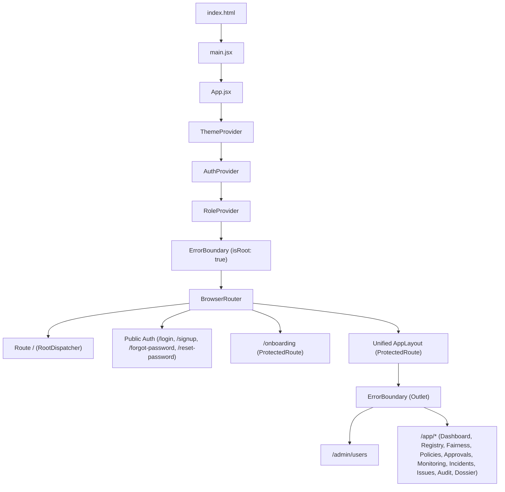

# Aegis AI — Frontend Architecture & UI Engineering

This document details the frontend implementation, state management, component hierarchy, design systems, and regression-prevention architecture in Aegis AI.

---

## 1. Technical Framework & Dependencies

- **Framework:** React 19.2 (`react`, `react-dom`)
- **Build Tool:** Vite 8.3 (`@vitejs/plugin-react` v6.1)
- **Routing:** React Router 7.18 (`react-router-dom`)
- **Iconography:** Lucide React v1.44
- **Linter:** Oxlint v1.81 (`.oxlintrc.json`)
- **Port:** `3000` (Local dev server with proxy to `:5000` for `/api`)

---

## 2. Application Entry & Routing Architecture

### Entry Point Sequence:
1. **`index.html`:** Mounts `

` and asynchronously loads Google Identity Services script (`https://accounts.google.com/gsi/client`).
2. **`main.jsx`:** Mounts `<App />` into the DOM root.
3. **`App.jsx`:** Initializes provider hierarchy, wraps root `<ErrorBoundary isRoot>`, and registers all application routes.

---

## 3. Route Guarding & Dispatch Mechanics

### Root Route Dispatcher (`RootDispatcher` in `App.jsx`):
- If `loading`: Renders `<ProtectedRoute />` loading skeleton.
- If unauthenticated: Renders `<Landing />`.
- If `user.status === 'SUSPENDED'`: Renders `<SuspendedNotice />`.
- If `!user.onboardingCompleted`: Redirects to `/onboarding`.
- If `user.role === 'PLATFORM_ADMIN'`: Redirects to `/admin/users`.
- If standard authenticated user: Redirects to `/app`.

### Public Route Guard (`PublicOnlyRoute`):
- Intercepts authenticated `ACTIVE` users visiting `/login` or `/signup` and bounces them to their designated workspace (`/admin/users` or `/app`).

### Protected Route Guard (`ProtectedRoute.jsx`):
- Displays high-fidelity "Verifying session..." compass loader while `loading` is true.
- Redirects unauthenticated visitors to `/login?redirect=...`.
- Intercepts suspended accounts with `<SuspendedNotice />`.
- Intercepts role mismatches (e.g. non-admins accessing `/admin/*`) with `<AccessDeniedNotice />`.

---

## 4. Context Architecture & Legacy Role Eviction

### 1. `AuthContext.jsx`
- Manages `user`, `token`, `isAuthenticated`, `loading`, and `error`.
- Orchestrates session bootup: reads `'aegis_token'` from `localStorage`, validates against `/api/auth/me`, and triggers silent cookie refresh if 401 occurs.
- **Legacy Role Eviction:** Explicitly inspects the restored user token. If an obsolete role (`ETHICS_OFFICER`, `COMPLIANCE_OFFICER`, `EXECUTIVE_SPONSOR`, or `EMPLOYEE`) is detected, it wipes `localStorage`, clears the session, and triggers a clean re-authentication flow with a clear prompt.
- Listens to window custom event `'aegis:unauthorized'` fired by `api.js` to execute automatic token rotation without breaking active UI state.

### 2. `RoleContext.jsx`
- Exposes `currentRole`, `switchRole`, `roles` (`PLATFORM_ADMIN`, `ML_LEAD`, `GOVERNANCE_OFFICER`, `EXECUTIVE_APPROVER`), and `isAuthoritative`.
- **Server-Authoritative Enforcement:** When authenticated, `currentRole` derives strictly from `user.role`. Any attempt to call `switchRole` prints a warning and is ignored. Preserves demo role selection exclusively for unauthenticated flows.

### 3. `ThemeContext.jsx`
- Stores and toggles light and dark modes (`light` / `dark`), persisting preferences in `localStorage.getItem('aegis_theme')`.
- Sets `data-theme` attribute on `document.documentElement` to trigger CSS custom properties in `index.css`.

---

## 5. Elimination of Blank-Screen Regressions

### Historical Regressions & Root Causes:
Early development iterations experienced intermittent "blank white page" crashes when navigating between routes or refreshing pages:
1. **Root Cause 1 — Competing Router Layouts:** Multiple nested router providers and redundant outer wrappers caused React Router v7 to lose route context on page changes.
2. **Root Cause 2 — Null Pointer Access During Session Hydration:** Pages attempted to read `user.role` or `user.department` before the asynchronous `/api/auth/me` call finished, throwing unhandled exceptions during the initial render pass.
3. **Root Cause 3 — Uncaught Errors Unmounting Root Tree:** Without error boundaries, any runtime exception in an individual table or chart would tear down the entire DOM tree, leaving a completely blank screen.

### Architectural Solution Implemented:
1. **Single Persistent `AppLayout`:** All authenticated pages render under a single `<AppLayout />` parent containing exactly one `<Sidebar />` and `<Navbar />` instance. Pages are projected via `<Outlet />`.
2. **Double-Layer Error Boundaries:**
   - **Root Boundary:** Catches catastrophic failures outside the layout and provides a clean "Something went wrong" screen with a reload button.
   - **Layout Boundary:** Wraps `<Outlet />` inside `AppLayout.jsx`. If an error occurs in an individual page (e.g. malformed audit payload), the sidebar and top navbar remain fully interactive, allowing the user to navigate away.
3. **Session Hydration Guards:** `ProtectedRoute` returns a clean loader while `loading` is true, ensuring no protected page ever renders with an unhydrated `user` object.
4. **Resilient Data State Handlers:** All pages implement the triad of UI states:
   - `<LoadingSkeleton />` during fetch.
   - `<ErrorState />` with retry button on API failure.
   - `<EmptyState />` when collections contain zero records.

---

## 6. Page Inventory & Role-Aware Experience

### Role-Aware Dashboard Customization ([Dashboard.jsx](file:///d:/Projects/govern/frontend/src/pages/Dashboard.jsx)):
The primary dashboard adapts dynamically to the authenticated persona:
- **`PLATFORM_ADMIN`:** Highlights user verification backlog, security posture, system health, and SHA-256 ledger integrity.
- **`ML_LEAD`:** Highlights model lineage, evaluation pass/fail velocity, drift alert summaries, and provides quick access to "Register Model".
- **`GOVERNANCE_OFFICER`:** Highlights institutional policy compliance, fairness audit ratios, pending stage-gate sign-offs, and open employee issue queues.
- **`EXECUTIVE_APPROVER`:** Highlights enterprise high-risk model portfolio, pending executive production sign-offs, and emergency rollback readiness.

### Core Pages:
- `/` — Marketing Landing Page (`Landing.jsx`)
- `/login`, `/signup` — Separated Authentication Pages (`Login.jsx`, `Signup.jsx`)
- `/forgot-password`, `/reset-password` — Password Recovery Pages
- `/onboarding` — Multi-step Post-Registration Setup (`Onboarding.jsx`)
- `/admin/users` — User Verification & Role Management Console (`AdminUsers.jsx`)
- `/app` — Role-Aware Executive Governance Dashboard (`Dashboard.jsx`)
- `/app/registry` — Centralized Model Registry (`ModelRegistry.jsx`)
- `/app/models/:id` — Detailed Model Lineage & Version Cards (`ModelDetails.jsx`)
- `/app/evaluation` — Fairness Studio & Benchmark Uploader (`FairnessStudio.jsx`)
- `/app/policies` — Governance Rule Gating Console (`PolicyManagement.jsx`)
- `/app/approvals` — Multi-Stakeholder Stage Gate Sign-Offs across 3 Domain Roles (`ApprovalCenter.jsx`)
- `/app/monitoring` — Dual-Pipeline Runtime Drift & Telemetry Console (`Monitoring.jsx`)
- `/app/incidents` — Incident Management & Atomic 1-Click Rollback Orchestration (`IncidentManagement.jsx`)
- `/app/issues` — Employee Governance Issue Reporting & Escalation Console (`IssueReporting.jsx`)
- `/app/audit` — Cryptographic SHA-256 Chained Audit Trail (`AuditTrail.jsx`)
- `/app/dossier` — 1-Click Regulatory Compliance Dossier (`ComplianceDossier.jsx`)
- `/app/profile` — User Account Settings & Activity History (`UserProfile.jsx`)
