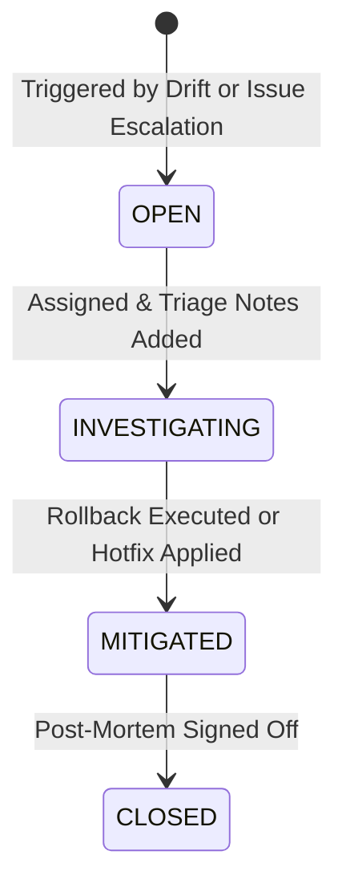

# Aegis AI — Incident Management & Atomic Rollback Engine

This document details the incident lifecycle, triage capabilities, escalation flows, deduplication logic, and the atomic version rollback engine implemented in Aegis AI.

---

## 1. Incident Lifecycle State Machine

Incidents progress through four distinct states defined in [backend/src/models/Incident.js](file:///d:/Projects/govern/backend/src/models/Incident.js):



- **`OPEN`:** Incident automatically created by runtime drift detection or escalated from an employee issue report. Awaiting initial triage.
- **`INVESTIGATING`:** Assigned to an `ML_LEAD` or `GOVERNANCE_OFFICER`. Human investigation notes actively appended via `POST /api/incidents/:id/notes`.
- **`MITIGATED`:** The operational risk has been neutralized (e.g. via 1-click model rollback to the approved baseline version).
- **`CLOSED`:** Root cause identified, post-mortem documented, and regulatory reporting completed.

---

## 2. Incident Generation Pathways

### Pathway A: Automated Drift Escalation (`incidentService.js`)
Triggered automatically when runtime telemetry evaluates statistically significant drift (PSI $\ge 0.25$ via simulation or statistical hypothesis rejection via real Evidently AI):
- **Deduplication Safeguard:** Before creating a new incident, the engine checks for an existing active incident (`OPEN` or `INVESTIGATING`) for the same `modelId` and `versionId`. If found:
  - Re-links the latest `telemetryRef`.
  - Refreshes `metricsSnapshot` (columns drifted, PSI, sample size, timestamp).
  - Escalates severity to `HIGH` if warranted (e.g., sensitive column drifted or PSI > 0.30).
  - Appends re-confirmation notes to `mitigationNotes`.
  - Records an audit ledger event `INCIDENT_UPDATED`.
- **New Incident Creation:** If no active incident exists:
  - Generates sequential incident number (`#INC-001`, `#INC-002`, etc.).
  - Identifies the latest previously approved baseline version and assigns it as `recommendedRollbackVersionId`.
  - Sets `type = 'DATA_DRIFT'`, `severity = 'HIGH'` or `'MEDIUM'`.
  - Sets bidirectional linkage with `telemetryRef`.
  - Records audit event `INCIDENT_CREATED`.

### Pathway B: Employee Issue Escalation (`issueService.js`)
Employees and operational users report observed anomalies (e.g., disparate loan denials, customer fairness violations, hallucinations) via `POST /api/issues`.
- A governance stakeholder (`ML_LEAD` or `GOVERNANCE_OFFICER` with `ISSUES_MANAGE` permission) reviews submitted reports at `/app/issues`.
- Clicking **"Escalate to Incident"** (`POST /api/issues/:id/escalate`) converts the report into a formal `#INC-xxx` record.
- **Bidirectional Reference Linkage:**
  - `IssueReport.escalatedIncidentId` is set to the new `Incident._id`.
  - `Incident.issueReportRef` is set to the source `IssueReport._id`.
  - Issue report status transitions to `ESCALATED_TO_INCIDENT`.
- Emits immutable audit events: `ISSUE_ESCALATED_TO_INCIDENT` and `INCIDENT_CREATED`.

---

## 3. Atomic Version Rollback Engine (`executeRollback`)

Rollback execution is governed by [backend/src/services/incidentService.js](file:///d:/Projects/govern/backend/src/services/incidentService.js).

### Authorized Roles:
- `ML_LEAD`: Technical model owner remediating operational divergence.
- `EXECUTIVE_APPROVER`: Executive authority executing emergency mitigation.
- *`PLATFORM_ADMIN` is strictly unauthorized to trigger rollbacks (enforcing segregation of duties).*

### Strict Governance Prerequisites:
> **Non-Negotiable Rollback Gate:** A rollback is **ONLY permitted to a version that previously PASSED governance policies and was APPROVED** (or served as an authenticated production baseline).

Before executing state changes, the engine verifies:
```javascript
const isApprovedOrProductionBaseline =
  targetVersion.policyStatus === 'PASSED' &&
  (
    targetVersion.approvalStatus === 'APPROVED' ||
    targetVersion.deploymentStatus === 'IN_PRODUCTION' ||
    targetVersion.deploymentStatus === 'RETIRED' ||
    targetVersion.lifecycleStatus === 'APPROVED' ||
    targetVersion.lifecycleStatus === 'DEPRECATED'
  );

if (!isApprovedOrProductionBaseline) {
  throw new Error(
    `ROLLBACK GATE BLOCKED: Target version ${targetVersion.version} cannot be deployed via rollback because it failed governance policies (Policy Status: ${targetVersion.policyStatus}, Approval Status: ${targetVersion.approvalStatus}, Deployment Status: ${targetVersion.deploymentStatus}). Rollback is only permitted to genuinely approved versions.`
  );
}
```

### Atomic State Transition Steps:
1. **Emit Audit Start:** Records `ROLLBACK_STARTED` in the immutable ledger.
2. **Demote Active Drifting Version:**
   - `lifecycleStatus` = `'DEPRECATED'`
   - `deploymentStatus` = `'ROLLED_BACK'`
   - `rolledBackAt` = `new Date()`
3. **Restore Target Baseline Version:**
   - `lifecycleStatus` = `'IN_PRODUCTION'`
   - `deploymentStatus` = `'IN_PRODUCTION'`
   - `deployedAt` = `new Date()`
4. **Update Parent Model Pointer:**
   - Sets `model.currentProductionVersionId = targetVersion._id`.
   - Sets `model.lifecycleStatus = 'IN_PRODUCTION'`.
5. **Mitigate Linked Incident (if provided):**
   - Sets `incident.status = 'MITIGATED'`.
   - Appends mitigation summary: `[Mitigated]: Rolled back to v1.0 by <Actor> on <ISO_Timestamp>`.
   - Sets `resolvedAt` and `resolvedBy`.
6. **Emit Audit Completion:** Records `ROLLBACK_COMPLETED` with SHA-256 block sealing.
