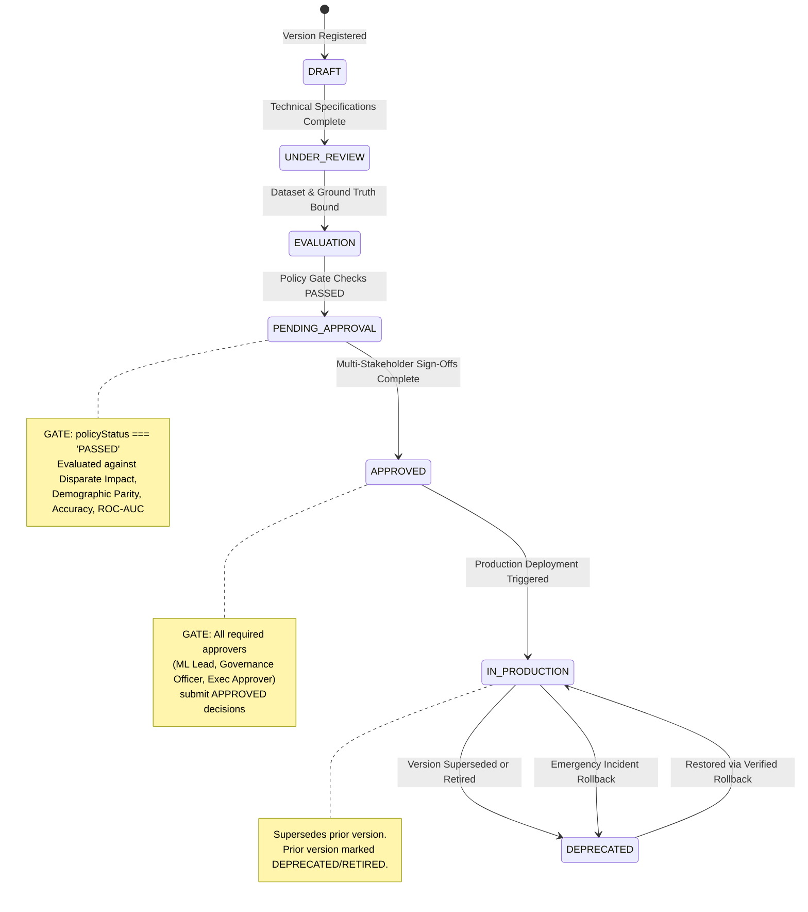

# Aegis AI — Model Lifecycle & Governance Gating

This document defines the complete model version lifecycle, state machine transitions, stage gates, and deployment policies in Aegis AI.

---

## 1. Lifecycle Progression State Machine

The official model version lifecycle stages are defined in [backend/src/services/lifecycleService.js](file:///d:/Projects/ai%20govern/backend/src/services/lifecycleService.js):



---

## 2. Stage Definitions

| Lifecycle Stage | System Meaning & Context | Prerequisites to Enter | Permissions Required |
|---|---|---|---|
| **`DRAFT`** | Initial definition of model version. Code repository references, training lineage, and hyperparameters recorded. | Parent Model registered in registry. | `ML_LEAD` |
| **`UNDER_REVIEW`** | Technical documentation, risk self-assessment, and protected demographic attributes established. | Must transition from `DRAFT`. | `ML_LEAD` |
| **`EVALUATION`** | Benchmark validation dataset bound. Statistical fairness, bias metrics, and predictive scores calculated. | Must transition from `UNDER_REVIEW` (or `DRAFT`). | `ML_LEAD` |
| **`PENDING_APPROVAL`** | Model version submitted for formal governance sign-off. | **Gate 1:** Evaluation completed AND **`policyStatus === 'PASSED'`**. Blocked if any mandatory policy fails. | `ML_LEAD` |
| **`APPROVED`** | Model certified compliant with internal policies and regulatory frameworks (EU AI Act Annex III). | **Gate 2:** Mandatory sign-offs submitted with comments from all required approvers. | Multi-role sign-offs |
| **`IN_PRODUCTION`** | Model serving live production inference recommendations. | Must be in `APPROVED` status. Automatically supersedes previous production versions. | `ML_LEAD` |
| **`DEPRECATED`** | Model version retired from active service, superseded by a newer approved release, or rolled back. | Superseded by new deployment or deprecated manually. | `ML_LEAD` / System |

---

## 3. Implementation Reality: `DEPRECATED` vs `RETIRED`

### Critical Code Evidence:
In [backend/src/models/ModelVersion.js](file:///d:/Projects/ai%20govern/backend/src/models/ModelVersion.js), the schema tracks **two distinct status fields**:

1. **`lifecycleStatus` (Lifecycle Stage):**
   ```javascript
   lifecycleStatus: { 
     type: String, 
     enum: ['DRAFT', 'UNDER_REVIEW', 'EVALUATION', 'PENDING_APPROVAL', 'APPROVED', 'IN_PRODUCTION', 'DEPRECATED'],
     default: 'DRAFT',
     required: true 
   }
   ```
2. **`deploymentStatus` (Deployment State):**
   ```javascript
   deploymentStatus: { 
     type: String, 
     enum: ['NOT_DEPLOYED', 'STAGING', 'IN_PRODUCTION', 'ROLLED_BACK', 'RETIRED'],
     default: 'NOT_DEPLOYED' 
   }
   ```

### State Coordination in `lifecycleService.js`:
When a new version is promoted to `IN_PRODUCTION`, the previous production version is updated simultaneously:
```javascript
if (previousProdVersion) {
  previousProdVersion.lifecycleStatus = 'DEPRECATED';
  previousProdVersion.deploymentStatus = 'RETIRED';
  await previousProdVersion.save();
}
```
And when transitioning explicitly to `DEPRECATED`:
```javascript
case 'DEPRECATED':
  if (version.deploymentStatus === 'IN_PRODUCTION') {
    version.deploymentStatus = 'RETIRED';
  }
  break;
```

**Architectural Rule:** Do not modify these enum values in database schemas merely to alter frontend wording. In Aegis AI, the lifecycle progression status is `DEPRECATED`, and the deployment target state is `RETIRED`.

---

## 4. Stage Gate Verification Details

### Gate 1: Policy Evaluation Gate (`EVALUATION` → `PENDING_APPROVAL`)
- Evaluated via `POST /api/policies/check/:versionId` or inside `transitionVersionLifecycle`.
- Rejects transition if `version.policyStatus !== 'PASSED'`:
  ```text
  GOVERNANCE GATE BLOCKED: Model version v1.1 cannot enter PENDING_APPROVAL because governance policies have not passed (Current Policy Status: FAILED).
  ```
- Reasons for policy blocking:
  - Disparate Impact Ratio (DIR) $< 0.80$ (Four-Fifths Rule violation).
  - Demographic Parity Difference $> 0.10$.
  - ROC-AUC $< 0.85$ (or policy-configured minimum).
  - Classification as `UNACCEPTABLE` risk under EU AI Act Article 5.

### Gate 2: Approval Gate (`PENDING_APPROVAL` → `APPROVED`)
- Resolves all mandatory approver roles required by applicable policy (model-specific policy checked first, then risk-tier default):
  `['ML_LEAD', 'GOVERNANCE_OFFICER', 'EXECUTIVE_APPROVER']`.
- Queries `Approval` records for `versionId`.
- Verifies every required role has submitted `decision: 'APPROVED'`.
- Missing any role sign-off immediately throws:
  ```text
  APPROVAL GATE BLOCKED: Missing mandatory sign-offs from: [GOVERNANCE_OFFICER, EXECUTIVE_APPROVER]. All required roles must approve before version is APPROVED.
  ```

### Gate 3: Deployment Gate (`APPROVED` → `IN_PRODUCTION`)
- Strictly verifies current status is `APPROVED`.
- Demotes existing active version to `lifecycleStatus: 'DEPRECATED'`, `deploymentStatus: 'RETIRED'`.
- Updates parent `Model.currentProductionVersionId` pointer to new version.
- Emits immutable audit event `DEPLOYMENT_COMPLETED`.

---

## 5. Rollback Interaction

When production telemetry detects critical drift ($PSI \ge 0.25$) or an operational incident occurs:
1. `executeRollback` in [incidentService.js](file:///d:/Projects/ai%20govern/backend/src/services/incidentService.js) verifies that the target version has `policyStatus === 'PASSED'` and was previously approved.
2. The current drifting model is set to:
   - `lifecycleStatus = 'DEPRECATED'`
   - `deploymentStatus = 'ROLLED_BACK'`
   - `rolledBackAt = new Date()`
3. The target restored version is promoted directly to:
   - `lifecycleStatus = 'IN_PRODUCTION'`
   - `deploymentStatus = 'IN_PRODUCTION'`
   - `deployedAt = new Date()`
4. Parent model pointer is updated, incident status moves to `MITIGATED`, and cryptographic audit records (`ROLLBACK_STARTED`, `ROLLBACK_COMPLETED`) are appended to the ledger.
