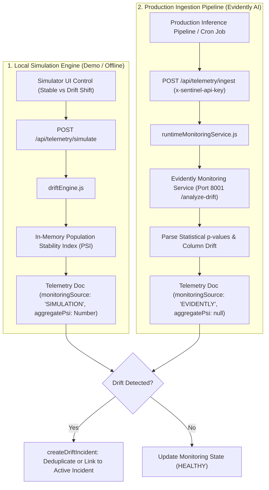

# Aegis AI — Runtime Monitoring & Data Drift Engine

This document details the telemetry monitoring system, distribution drift detection algorithms, real Evidently AI pipeline integration, and operational threshold rules implemented in Aegis AI.

---

## 1. Dual-Engine Telemetry Architecture

Aegis AI operates two complementary telemetry ingestion engines:

---

## 2. Population Stability Index (PSI) Algorithm (Simulation Engine)

Aegis AI evaluates simulated feature shifts against training baseline distributions using the **Population Stability Index (PSI)** implemented in [backend/src/services/driftEngine.js](file:///d:/Projects/govern/backend/src/services/driftEngine.js).

### Mathematical Definition:
For each feature partitioned into $K$ discrete quantile distribution bins:

$$\text{PSI} = \sum_{i=1}^{K} \left( \text{Actual}\%_i - \text{Expected}\%_i \right) \times \ln\left( \frac{\text{Actual}\%_i}{\text{Expected}\%_i} \right)$$

- **$\text{Expected}\%_i$:** Percentage of observations falling in bin $i$ during training or baseline calibration.
- **$\text{Actual}\%_i$:** Percentage of observations falling in bin $i$ during the current production inference window.
- **Epsilon Guard:** An $\epsilon = 0.0001$ smoothing floor prevents division by zero or taking the logarithm of zero.

### PSI Drift Thresholds:
| Calculated PSI Range | Health Status | System Meaning & Operational Action |
|---|:---:|---|
| **$\text{PSI} < 0.10$** | **`HEALTHY`** | Insufficient change detected. The production population matches baseline training distributions. No intervention required. |
| **$0.10 \le \text{PSI} < 0.25$** | **`WARNING`** | Moderate distribution shift observed. Flags warning badge on monitoring dashboards. Suggests exploratory investigation by ML Lead. |
| **$\text{PSI} \ge 0.25$** | **`DRIFT_DETECTED`** | **Significant distribution drift.** Automatically triggers high-severity Incident escalation and links rollback recommendation. |

---

## 3. Real Evidently AI Runtime Telemetry Ingestion Pipeline

Implemented in [backend/src/services/runtimeMonitoringService.js](file:///d:/Projects/govern/backend/src/services/runtimeMonitoringService.js) and mounted at `POST /api/telemetry/ingest`:

### Pipeline Characteristics:
1. **API Key Authentication:** Ingestion requests are authenticated using the `x-sentinel-api-key` HTTP header, verified against `process.env.SENTINEL_INGESTION_KEY` by `authenticateIngestion` middleware.
2. **Column Validation:** Incoming records must contain all required operational and monitoring columns:
   - `fraud_risk_score`, `ml_supervised_score`, `ml_anomaly_score`, `rule_heuristic_score`, `latency_ms`.
3. **Evidently Service Integration:** Batches are forwarded to the Sentinel Monitoring Service (`http://127.0.0.1:8001/analyze-drift`, powered by Evidently AI 0.7.23).
4. **Zero Fake PSI Invariant:**
   - Evidently computes statistical hypothesis test metrics (e.g. Kolmogorov-Smirnov p-values) rather than PSI.
   - Aegis AI **strictly sets `aggregatePsi = null`** on all Evidently telemetry documents. Fabricating an artificial PSI value is prohibited under Rule 8 (No Fabrication).
   - Features store `statisticalMethod: 'EVIDENTLY'`, `pValue`, `threshold: 0.05`, and `driftDetected: Boolean`.
5. **Monitoring State Document Update:**
   - Automatically synchronizes the model version's `Monitoring` record with `driftMethod: 'EVIDENTLY'`, `healthStatus: driftDetected ? 'CRITICAL' : 'HEALTHY'`, and updates `telemetryRef`.
6. **Controlled Error Handling:**
   - If the Evidently service is unreachable, returns structured HTTP 503 (`MONITORING_SERVICE_UNAVAILABLE`) without persisting corrupt or half-formed documents.

---

## 4. External AI Model Scoring Service Adapter

Implemented in [backend/src/services/externalAiAdapter.js](file:///d:/Projects/govern/backend/src/services/externalAiAdapter.js):
- **Core Principle:** *"The AI model does the AI work; Sentinel Govern governs the AI model."*
- Connects Sentinel Control Plane to an external FastAPI model serving instance (`http://127.0.0.1:8000`).
- **Exported Functions:**
  - `checkExternalAiHealth()`: Verifies connectivity via `GET /health`.
  - `scoreTransactionWithExternalAi(transactionPayload)`: Scores a single transaction via `POST /score`, returning supervised, anomaly, heuristic scores, and decision.
  - `scoreTransactionsBatch(transactions)`: Executes batch scoring ready for Sentinel governance ingestion.

---

## 5. Important Governance Invariants

### Invariant 1: Drift Escalation Never Triggers Silent Rollbacks
> **Critical Safety Rule:** When significant drift ($\text{PSI} \ge 0.25$ or statistical drift in Evidently) is detected, the engine **creates an incident**, but **DOES NOT automatically mutate lifecycle status or rollback the model**.

Rollbacks require human review and explicit execution by authorized stakeholders (`ML_LEAD` or `EXECUTIVE_APPROVER`).

### Invariant 2: Active Incident Aggregation & Deduplication
When recurring drift telemetry arrives for a model version that already has an active open incident (`OPEN` or `INVESTIGATING`):
1. The engine updates the existing incident, refreshes telemetry metrics snapshots, and appends time-stamped telemetry notes.
2. It **never generates duplicate incident tickets** for an ongoing drift condition.
3. Arriving stable telemetry batches do **never delete, close, or silence active open incidents**.

### Invariant 3: Bidirectional Linkage
`Telemetry.incidentId` $\leftrightarrow$ `Incident.telemetryRef` are atomically linked to guarantee complete auditability in compliance dossiers.
