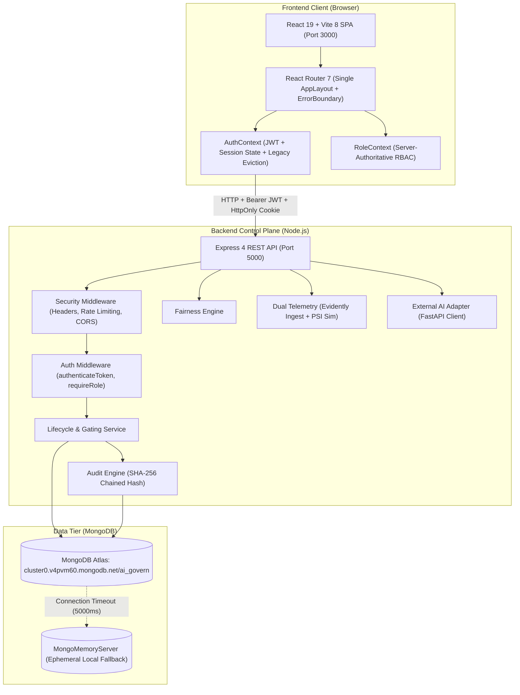

# Sentinel Govern — Master Project Context & Canonical Project Memory

## 1. Project Identity

- **Canonical Project Name:** Sentinel Govern
- **Preferred Descriptive Name:** Sentinel Govern — AI Governance & Lifecycle Platform
- **Historical Precursor:** Formerly titled Aegis AI during early development phases.
- **Classification:** Enterprise AI Governance, Responsible AI, and Model Lifecycle Management Platform
- **Canonical Problem Statement:**
  > “Organizations deploying AI solutions require governance mechanisms to monitor model performance, approvals, version control, fairness, compliance, and auditability. This platform manages the complete AI model lifecycle while ensuring responsible AI practices.”

### Purpose
Aegis AI acts as the operational **control plane and regulatory governance layer** for enterprise machine learning and artificial intelligence systems. It provides visibility, policy enforcement, multi-stakeholder sign-off gates, statistical fairness verification, runtime drift detection, automated incident management, atomic version rollbacks, and an immutable cryptographic audit ledger.

### Scope
- Centralized Model Registry with regulatory risk categorization (EU AI Act Annex III, NIST AI RMF 1.0, ISO/IEC 42001).
- Granular version lineage, training dataset metadata, and documentation requirements.
- In-memory statistical fairness audits (Disparate Impact Ratio with the 80% legal threshold, Demographic Parity Difference, Equalized Odds TPR/FPR parity).
- File upload for evaluation benchmarks (.csv and .xlsx) without executing server-side training.
- Multi-stakeholder approval stage gates enforcing strict separation of duties across 3 domain approvers (ML Lead, Governance Officer, Executive Approver).
- Dual-pipeline runtime monitoring: Real Evidently AI 0.7.23 ingestion with the Zero Fake PSI Invariant (`aggregatePsi: null`), alongside in-memory Population Stability Index (PSI) simulation.
- Automated incident escalation (#INC-xxx) with active deduplication, and safe, atomic 1-click model rollbacks to approved baselines.
- SHA-256 hash-chained immutable audit ledger tracking 41 authentication, governance, and lifecycle actions.
- 1-click exportable regulatory compliance dossiers (JSON, Markdown, PDF-ready summary).
- Dual authentication system: Google Identity Services (GIS OAuth2) and native email/password with Bcrypt and HttpOnly refresh token rotation.
- Fine-grained Role-Based Access Control (RBAC) with 4 canonical roles, 26 permissions, account verification states, and legacy role eviction.

### Explicit Non-Goals
1. **Model Training:** Aegis AI is not a model training framework (it does not run TensorFlow, PyTorch, Scikit-Learn training pipelines, or GPU clusters). It evaluates and governs models based on evaluation metadata and benchmark datasets.
2. **Model Serving/Inference Proxy:** Aegis AI does not host real-time prediction endpoints for raw production traffic. Instead, production inference is decoupled and served by external services (e.g., FastAPI on port 8000 via `externalAiAdapter.js`), and statistical metrics are ingested via REST APIs.
3. **Blanket Administrative Superusers:** Platform Administrators do not possess blanket permissions to create models, submit domain approval sign-offs, or execute rollbacks, preserving regulatory separation of duties.
4. **Social Network Features:** User profile photos are stored as text URLs or initials; avatar uploads and social collaboration features are explicitly out of scope.

---

## 2. Current Architecture Summary

The platform is structured as a modern full-stack decoupled web application using the MERN stack with strict architectural boundaries:

- **Frontend:** React 19.2, Vite 8.3, React Router 7.18, Lucide React icons. Role-personalized dashboards, full responsive sidebar layout, and root/component ErrorBoundaries.
- **Backend:** Node.js (v18+ / verified v24.18), Express 4.21, Mongoose 8.9, native crypto (SHA-256), bcryptjs, jsonwebtoken, cookie-parser, multer, xlsx.
- **Database:** MongoDB Atlas (database `ai_govern`) with automatic local fallback to `mongodb-memory-server` (v10.1.3), and safe dev reset via `backend/src/seed/resetDevDb.js`.
- **Authentication:** Dual provider support (Google Identity Services ID Token verification + Native email/password signup and login with secure refresh cookie rotation).
- **Authorization:** Server-authoritative RBAC with 4 canonical roles, 26 permissions, account verification gating, and immutable audit logging.

---

## 3. Currently Implemented Roles

The platform enforces 4 canonical roles defined in [backend/src/config/permissions.js](file:///d:/Projects/govern/backend/src/config/permissions.js):

| Role Identifier | Role Title | Primary Responsibilities | Administrative / Domain Boundary |
|---|---|---|---|
| `PLATFORM_ADMIN` | Platform Administrator | User management, account verification, role assignment, system configuration, audit integrity oversight. | **CANNOT** create models, sign off on approval gates, or execute rollbacks. |
| `ML_LEAD` | ML & Data Science Lead | Model registration, version creation, lifecycle stage transitions, evaluation execution, incident investigation, version rollbacks. | Domain owner for technical modeling and operational telemetry. |
| `GOVERNANCE_OFFICER` | AI Governance Officer | Unifies ethical fairness audits and compliance oversight; policy creation/editing, stage-gate review sign-offs, employee issue triage. | Independent oversight for societal, ethical, and regulatory risks. |
| `EXECUTIVE_APPROVER` | Executive Approver | Executive risk sign-off, final production approval authorization, business risk acceptance, emergency rollback execution. | Executive business authority and gatekeeper. |

---

## 4. Current Lifecycle Stages & Transition Rules

The authoritative model lifecycle stages are defined in [backend/src/services/lifecycleService.js](file:///d:/Projects/govern/backend/src/services/lifecycleService.js) and [backend/src/models/ModelVersion.js](file:///d:/Projects/govern/backend/src/models/ModelVersion.js):

$$\mathbf{DRAFT} \longrightarrow \mathbf{UNDER\_REVIEW} \longrightarrow \mathbf{EVALUATION} \longrightarrow \mathbf{PENDING\_APPROVAL} \longrightarrow \mathbf{APPROVED} \longrightarrow \mathbf{IN\_PRODUCTION} \longrightarrow \mathbf{DEPRECATED}$$

### Transition Stage Gates:
1. **DRAFT → UNDER_REVIEW:** Initial model definition and intended purpose documented.
2. **UNDER_REVIEW → EVALUATION:** Evaluation dataset bound; metrics ready for benchmarking.
3. **EVALUATION → PENDING_APPROVAL:** **Gated.** Must have completed evaluation and achieved `policyStatus: 'PASSED'` against the model's active governance policy.
4. **PENDING_APPROVAL → APPROVED:** **Gated.** Requires affirmative approval sign-offs with comments from all 3 mandatory domain roles (ML Lead, Governance Officer, Executive Approver).
5. **APPROVED → IN_PRODUCTION:** **Gated.** Version must be in `APPROVED` status. Automatically deprecates any existing production version (`lifecycleStatus = 'DEPRECATED'`, `deploymentStatus = 'RETIRED'`).
6. **IN_PRODUCTION → DEPRECATED:** Superseded by a newly promoted version, or actively deprecated during incident remediation.
7. **Emergency Rollback:** Atomic restoration of a previously approved version directly to `IN_PRODUCTION`.

*Note on Terminology Discrepancy:* In the active codebase, `lifecycleStatus` enum utilizes `DEPRECATED`, while `deploymentStatus` enum utilizes `RETIRED`. Both terms exist concurrently in the database schema. See [docs/CONTRADICTIONS.md](file:///d:/Projects/govern/docs/CONTRADICTIONS.md) for full analysis.
