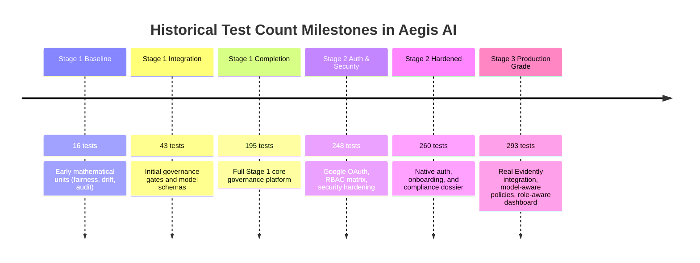

# Aegis AI — Testing Architecture & Verification Results

This document records the automated testing framework, test suite inventories, historical milestone counts, and the authoritative verification results for Aegis AI.

---

## 1. Authoritative Verified Test Execution

*Executed and Verified on: 2026-10-09 | Working Directory: `d:\Projects\govern\backend`*

```text
Current verified test result:
293 passed
0 failed
0 skipped
0 cancelled
0 todo
Date: 2026-10-09
Command: npm test (node --test tests/*.test.js)
Duration: ~42 seconds
Result Status: 100% PASSING
```

---

## 2. Test Framework & Runner Architecture

- **Runner:** Node.js Native Test Runner (`node:test` and `node:assert`).
- **Zero Third-Party Test Runners:** Does not rely on Jest, Mocha, or Vitest for backend suites, eliminating configuration drift and memory leaks.
- **Database Isolation:** Leverages `mongodb-memory-server` (v10.1.3). Each test file boots or resets an isolated in-memory MongoDB instance.
- **Fast Execution:** All 293 integration, security, cryptographic, drift, and lifecycle assertions execute in approximately 42 seconds.

---

## 3. Inventory of the 22 Backend Test Suites

| Test Suite File | Test Count | Primary Scope & Subsystem Covered |
|---|:---:|---|
| **`security_hardening.test.js`** | 28 | Malformed JWTs, expiration notifications, secret isolation, tamper authorization, ObjectId parameter guards, file upload constraints, CORS, rate limiting. |
| **`native_auth.test.js`** | 29 | Native signup, Bcrypt hashing, constant-time password comparison, refresh token rotation, HttpOnly cookie options, forgot password token lifecycle. |
| **`onboarding_verification_master.test.js`** | 12 | Signup → Onboarding → Pending verification → Admin verification flow → Presence tracking. |
| **`google_auth_stage2.test.js`** | 18 | Google ID token cryptographic claims validation (aud, iss, exp, sub), bootstrap admin auto-provisioning, session JWT issuance. |
| **`frontend_auth_routing.test.js`** | 16 | Contract tests validating React Router guards, `ProtectedRoute` decisions, role-aware navigation rendering, and 401 broadcast events. |
| **`reports_dossier.test.js`** | 9 | Compliance dossier compilation across all 10 statutory sections, empty state integrity, RBAC restrictions, Markdown export formatting. |
| **`issue_reporting_incident.test.js`** | 22 | Employee issue submission, input validation, stakeholder triage, and issue-to-incident escalation mechanics. |
| **`model_governance_integration.test.js`** | 14 | Model registration, version creation, risk assessment updates, and end-to-end governance lifecycle flow. |
| **`monitoring_improvements.test.js`** | 18 | Population Stability Index calculations, quantile distributions, drift status classification, telemetry simulation ingestion. |
| **`evaluation_import.test.js`** | 24 | In-memory parsing of CSV/XLSX benchmark files, binary label normalization, and protected attribute detection. |
| **`rbac.test.js`** | 15 | Granular 26-permission matrix validation, 4 canonical roles, and Platform Admin domain restriction enforcement. |
| **`audit_integration.test.js`** | 22 | SHA-256 hash chaining, genesis block verification, live tamper detection, and ledger repair. |
| **`lifecycle_enforcement.test.js`** | 11 | State gate enforcement (`EVALUATION` → `PENDING_APPROVAL` → `APPROVED` → `IN_PRODUCTION`). |
| **`policy.test.js`** | 6 | Policy threshold comparisons (min DIR, max DPD, min ROC-AUC). |
| **`auth.test.js`** | 8 | Core JWT verification and authorization header handling. |
| **`fairness.test.js`** | 4 | Mathematical validation of DIR (80% rule) and Demographic Parity Difference. |
| **`drift.test.js`** | 5 | Mathematical validation of the PSI log-ratio formula. |
| **`audit.test.js`** | 4 | Core block hash computation and integrity checks. |
| **`dashboard_role_aware.test.js`** | 4 | Role-specific dashboard queue prioritization, empty DB handling, model without policy warnings, and Platform Admin metrics. |
| **`governance_flow_corrections.test.js`** | 5 | Active incident deduplication on repeated drift, non-deletion of open incidents by stable telemetry, rollback baseline discovery, completed approvals history, and model-policy binding. |
| **`model_aware_policy_management.test.js`** | 8 | Bidirectional model-policy association, policy library filtering by model, gate checks on unbound models, and policy reassignment RBAC. |
| **`runtime_monitoring_integration.test.js`** | 15 | Real Evidently AI 0.7.23 ingestion, normalization without fake PSI (`aggregatePsi: null`), incident generation on statistical drift, API key authentication, and service resilience. |
| **Total** | **293** | **Authoritative Full-Stack Backend Coverage (100% Passing)** |

---

## 4. Reconciliation of Historical Test Count Milestones

Previous project handoffs recorded different test totals. These represent legitimate progressive milestones across project phases:



- **16 Tests:** Initial mathematical unit tests (`fairness.test.js`, `drift.test.js`, `audit.test.js`, `policy.test.js`).
- **43 Tests:** Added basic lifecycle transitions and approval mocks.
- **195 Tests:** Completed Stage 1 core governance features.
- **248 Tests:** Added Stage 2 Phase 1–5 (Google Identity Services, RBAC matrix, Security hardening).
- **260 Tests:** Added Stage 2 Phase 6–10 (Native email/password auth, refresh token rotation, master onboarding verification, and Compliance Dossier suites).
- **293 Tests (CURRENT AUTHORITATIVE):** Added Stage 3 (Real Evidently AI runtime ingestion pipeline, zero fake PSI verification, bidirectional model-policy associations, role-aware dashboard personalization, and incident deduplication).

---

## 5. Frontend Build & Quality Verification

- **Build Verification Command:** `npm run build` in `frontend/`
  - Bundler: Vite v8.3.0
  - Output: `dist/index.html` (1.36 kB), `dist/assets/index-*.css` (24.91 kB), `dist/assets/index-*.js` (645.58 kB)
  - Result: Built in 1.98s with **0 errors**.
- **Linter Verification Command:** `npm run lint` in `frontend/`
  - Linter: Oxlint v1.81.0
  - Result: **0 errors**, 22 minor warnings (non-critical code styling recommendations).
