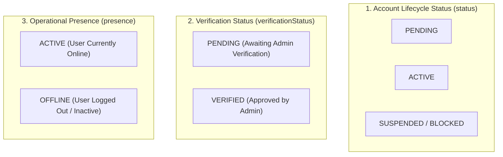
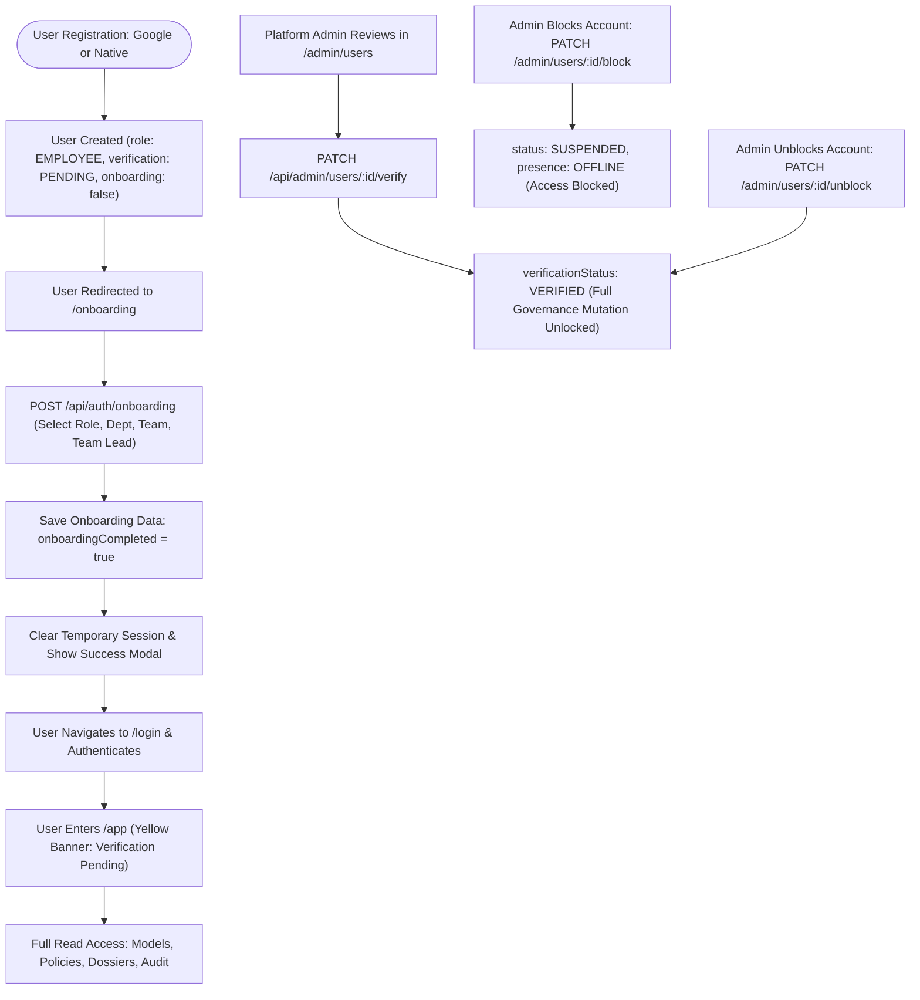

# Aegis AI — User Lifecycle & Account State Management

This document details the complete user lifecycle, account states, onboarding stages, presence tracking, and administrator management in Aegis AI.

---

## 1. Distinct State Vectors

Aegis AI explicitly separates three distinct concepts in the `User` schema ([backend/src/models/User.js](file:///d:/Projects/ai%20govern/backend/src/models/User.js)):

### 1. `status` (Account Lifecycle Status)
- Enum: `['PENDING', 'ACTIVE', 'SUSPENDED']` (Default: `'ACTIVE'`).
- Controls whether the account is legally permitted to access the platform.
- **`ACTIVE`:** Normal operational status.
- **`SUSPENDED`:** Account is blocked by an administrator. Authentication attempts and active requests are immediately rejected with HTTP 403.
- **`PENDING`:** Initial status for accounts created pending activation.

### 2. `verificationStatus` (Governance Verification Status)
- Enum: `['PENDING', 'VERIFIED']` (Default: `'PENDING'`).
- Enforces governance verification by a Platform Administrator before a user can perform state mutations.
- **`PENDING`:** User has full **read-only** browsing privileges across models, evaluations, policies, telemetry, incidents, and dossiers. Mutation endpoints (creating models, uploading evaluations, submitting sign-offs) are blocked with HTTP 403 and `code: 'VERIFICATION_PENDING'`.
- **`VERIFIED`:** Platform Administrator has explicitly verified the user's role and departmental credentials. Unlocks all role-authorized mutations.

### 3. `presence` (Operational Presence)
- Enum: `['ACTIVE', 'OFFLINE']` (Default: `'OFFLINE'`).
- Completely decoupled from `status`.
- Set to `'ACTIVE'` upon successful login or active API interaction (`/api/auth/me`).
- Set to `'OFFLINE'` upon explicit logout (`/api/auth/logout`) or account suspension.
- **Critical Invariant:** An offline user is **NOT** a blocked/suspended user.

---

## 2. Complete User Lifecycle Flow

---

## 3. Detailed Stage Descriptions

### Stage 1: Registration (Google or Native)
- **Google OAuth:** User clicks "Sign in with Google" → GIS credential verified by backend.
- **Native Signup:** User provides Name, Email, Password → Bcrypt hashes password (12 rounds).
- **Initial Profile:**
  - `role`: `'EMPLOYEE'` (unless email matches `BOOTSTRAP_ADMIN_EMAIL`).
  - `status`: `'ACTIVE'`.
  - `verificationStatus`: `'PENDING'` (Bootstrap Admin is `'VERIFIED'`).
  - `onboardingCompleted`: `false`.

### Stage 2: Post-Signup Onboarding Flow
- Uncompleted accounts trying to access protected routes are intercepted by `ProtectedRoute` and redirected to `/onboarding`.
- Onboarding collects:
  1. **Role:** `EMPLOYEE`, `ML_LEAD`, `ETHICS_OFFICER`, `COMPLIANCE_OFFICER`, or `EXECUTIVE_SPONSOR`.
     *(Selection of `PLATFORM_ADMIN` is strictly rejected with HTTP 403 unless the user is the bootstrap admin).*
  2. **Department:** e.g., "AI / ML", "Risk Management", "Compliance", "Engineering".
  3. **Team:** e.g., "AI Platform", "Machine Learning Engineering", "Risk Analytics".
  4. **Team Lead:** Text name or explicit "None (Independent Contributor)".
- **Completion Protocol:**
  - Calls `POST /api/auth/onboarding`.
  - Frontend immediately calls `logout()` to clear temporary tokens.
  - Displays modal: *"Account created successfully. Your Aegis account has been created. Please sign in to continue."*
  - Directs user to `/login`.

### Stage 3: Pending Verification State
- User signs in at `/login`.
- A persistent warning banner renders across the top of `AppLayout`:
  > **Account Verification Pending:** You have full read access to explore models, policies, and dossiers. Governance actions (creating models, running evaluations, approving policies) will activate once a Platform Administrator verifies your account.
- Backend enforcement via `requireVerifiedUser` middleware in `authMiddleware.js`.

### Stage 4: Administrator Verification & Role Management
- Platform Admin accesses `/admin/users`.
- Admin clicks **"Verify Account"** → calls `PATCH /api/admin/users/:id/verify`.
  - Sets `verificationStatus = 'VERIFIED'`.
  - Sets `verifiedBy = req.user.email`.
  - Sets `verifiedAt = new Date()`.
  - Emits immutable audit event `USER_VERIFIED`.
- Role assignment via `PATCH /api/admin/users/:id/role`.
  - Guard: Prevents demoting the last active Platform Administrator.
  - Emits audit event `ROLE_ASSIGNED`.

### Stage 5: Account Suspension (Block / Unblock)
- Admin clicks **"Suspend Account"** → calls `PATCH /api/admin/users/:id/block`.
  - Sets `status = 'SUSPENDED'`.
  - Sets `presence = 'OFFLINE'`.
  - Guard: Administrator cannot suspend their own active account.
  - Active JWT and refresh tokens are rejected immediately.
  - Emits audit event `USER_BLOCKED`.
- Admin clicks **"Restore Account"** → calls `PATCH /api/admin/users/:id/unblock`.
  - Sets `status = 'ACTIVE'`.
  - Emits audit event `USER_UNBLOCKED`.

### Stage 6: Session Termination & Presence
- User clicks "Sign Out" → calls `POST /api/auth/logout`.
- Revokes incoming refresh token cookie and clears cookie jar.
- Sets `presence = 'OFFLINE'`.
- Records `logoutAt = new Date()` in the user's `loginHistory` array.
- Emits audit event `USER_LOGOUT`.
