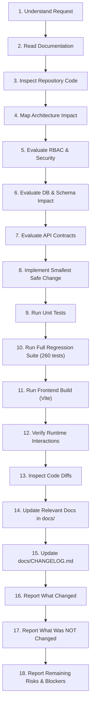

# Aegis AI — AI Agent Change Execution Protocol

Every AI coding assistant making code modifications to Aegis AI must execute the following 18-step protocol in sequence.

---

## The 18-Step Change Protocol



---

### Step 1: Understand the User Request
Deconstruct the user's requirements into atomic functional criteria. Determine whether the request is a bug fix, architectural refactoring, new feature, or documentation update.

### Step 2: Read Relevant Documentation in `docs/`
Consult the specific subsystem guides in `docs/` (e.g. `AUTHENTICATION.md`, `AUTHORIZATION_RBAC.md`, `MODEL_LIFECYCLE.md`, `API_REFERENCE.md`) to understand the established invariants.

### Step 3: Inspect the Repository
Read the exact source files and line ranges using file inspection tools. Do not rely on assumptions or past handoffs.

### Step 4: Identify Affected Architecture
Determine which architectural layers (Frontend React components, Express REST routes, Mongoose models, or cryptographic utilities) are impacted.

### Step 5: Identify Security & RBAC Implications
Verify whether the change affects:
- Separation of duties (ensure `PLATFORM_ADMIN` remains partitioned).
- Permissions matrix in `permissions.js`.
- Account verification status checks (`requireVerifiedUser`).
- Authentication token validation and cookie security.

### Step 6: Identify Database Implications
Determine whether Mongoose schemas require modification. If modifying schemas, ensure backward compatibility with existing seeded documents and avoid renaming active enums (`DEPRECATED`, `RETIRED`).

### Step 7: Identify API Contract Implications
Verify whether request bodies, query parameters, or response shapes change. Ensure that breaking changes are avoided unless explicitly requested.

### Step 8: Implement the Smallest Safe Change
Write clean, maintainable, defensive code. Preserve existing comments and docstrings. Follow established coding conventions.

### Step 9: Run Targeted Unit Tests
Run the specific test suite related to the modified subsystem (e.g. `node --test tests/native_auth.test.js`).

### Step 10: Run Full Backend Regression Tests
Execute the entire backend automated suite from `backend/`:
```bash
npm test
```
**Mandatory Requirement:** All 260 tests must pass with 0 failures.

### Step 11: Run Frontend Build & Linting
Execute the production build and linter from `frontend/`:
```bash
npm run build
npm run lint
```
**Mandatory Requirement:** The build must succeed with 0 errors.

### Step 12: Test Critical Runtime Flow
If applicable, verify that runtime interactions (such as login redirection, modal display, or API error handling) behave correctly.

### Step 13: Inspect Code Diffs
Review all modified files line-by-line. Ensure no sensitive credentials, temporary debug logs, or accidental file edits are introduced.

### Step 14: Update Documentation in `docs/`
Update the corresponding documentation files (e.g. `API_REFERENCE.md`, `CURRENT_STATE.md`, `DECISIONS.md`) to reflect the changes.

### Step 15: Update `docs/CHANGELOG.md`
Add a structured entry to `docs/CHANGELOG.md` recording the date, milestone, and exact changes made.

### Step 16: Report Exactly What Changed
Provide the user with an explicit summary of files modified, created, or deleted.

### Step 17: Report What Was NOT Changed
Explicitly confirm boundary constraints (e.g. "Did not alter schema enums", "Did not weaken RBAC permissions").

### Step 18: Report Remaining Risks & Open Tasks
Highlight any follow-up actions, manual browser checks, or deployment prerequisites required.
